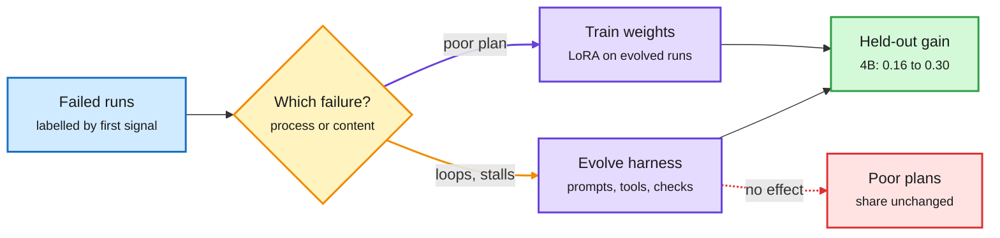

# Harness ceiling, typed memory routing, and trained orchestration

**Sources:** X Following feed, US day 2026-10-10 (@rohanpaul_ai, @dair_ai, @omarsar0, @shao__meng) · [Harness Evolution Hits a Ceiling, arXiv 2610.11655](https://arxiv.org/abs/2610.11655) · [MemoType, arXiv 2610.11573](https://arxiv.org/abs/2610.11573) (DAIR Academy pick, NeurIPS 2026) · [MASS, arXiv 2610.12176](https://arxiv.org/abs/2610.12176) (Sakana AI + Berkeley, DAIR pick) · [IdeaScientist, arXiv 2610.04074](https://arxiv.org/abs/2610.04074) (Meta, DAIR pick) · [Uber redlining agent](https://www.uber.com/us/en/blog/building-ubers-redlining-agent/)
**Raw:** `raw/twitter/feed/2026-10-1[01]-*-ranked.json` (private feed captures)

## TL;DR

The [harness engineering](agent-harness-engineering.md) page has carried one open question for months: does the harness or the model own a capability? **Harness Evolution Hits a Ceiling** (Stanford) gives the most operational answer yet. Label each failed run by the first failure signal. **Process failures** (blocked calls, loops, exhausted step budgets) are fixed by evolving the harness. **Content failures** (a delivered plan that is simply poor) are fixed only by training the weights. On DeepPlanning, a self-evolving harness lifts Qwen3.5-4B from 0.16 to 0.30 held-out (delivery 55% to 90%) and Qwen3.5-9B from 0.32 to 0.44, but never shrinks the share of poor plans. A LoRA adapter trained on evolved-harness runs cuts 9B content failures from about a quarter of runs to one in twenty, and alone matches the full evolution line. A placebo adapter (answers shuffled) falls below base. On WebArena-Lite the loop adds +0.09 on 117 unseen tasks, but there the gain lives in what the model sees and adapters add nothing.

Read the failure, then pick the lever

Loops and stalls go to the harness; bad plans go to the weights.

Blue is the run log, amber is the diagnosis, purple are the two levers, green is the result, red is what the harness cannot fix.

## The other items

- **MemoType (CityU Hong Kong + Huawei, NeurIPS 2026).** Retrieval-based agent memory treats every memory the same way. The paper proves any single retrieval strategy has an upper bound on expected precision when the store mixes memory types. MemoType trains a router that labels each memory and each query by type, retrieves only matching-type memories, and applies a type-specific strategy. A new dataset, TriMEM, supplies type labels. Recall@1 improves up to 16.18% across three datasets. It is routing applied to memory, the same "classify then dispatch" primitive the [routing page](../ai-routing/llm-routing.md) tracks for models.
- **MASS (Sakana AI + Berkeley).** Recursive self-improvement without an external verifier. One base model proposes multi-agent workflows, runs them, grades them; an evolutionary search keeps the best; the same model is fine-tuned on its own traces, covering both orchestration and bounded sub-agent execution, then resumes as solver, grader and optimizer. Two cycles on Qwen3.6-27B raise performance per output token 1.2-1.6x on four open-ended benchmarks. A student trained on multi-agent traces beats one trained on 1.4x more single-agent tokens.
- **IdeaScientist (Meta).** Research ideation as three RL-trained roles: gap finder, innovator (retrieves mechanisms from analogous problems in other fields over 2.77M decomposed ideas) and writer. Evaluation only allows literature before a cutoff and scores proposals against what 15K later human papers explored. A 27B open model beats the best open autoresearch baseline by 14% (mostly novelty) and Claude Code SDK and Codex SDK setups by up to 5.9%.
- **Uber's legal redlining agent (production).** Plain RAG over the negotiation playbook failed. Version 2 retrieves ~20 similar past decisions (counterparty text, lawyer edit, action, comment) with a 365-day half-life and balanced agree/disagree examples; v3 adds one "assume it is flawed" self-check call; v4 drafts counter-proposals against a lawyer-owned rules database. 91% decision accuracy, 20%+ faster reviews, no fine-tuning.
- Also circulating: a 17-author Huawei survey on agent design (model plus a six-part harness, four eras from prompts to agent-native training) and a "12 agentic harness patterns from Claude Code" X article.

## Relation to prior wiki pages

- **Gap-filling.** [Harness Evolution as Learning (10-05)](2026-10-05-githarness-and-harness-evolution-limits.md) found written rules fix style but not state, and memory helps only up to ~10 lines. The ceiling paper explains why: those are content-type limits that harness edits cannot reach.
- **Confirms (n=4).** [HAD/RSR/ASCENT (10-07)](2026-10-07-harness-internalization-had-rsr-ascent.md) showed harness wins can be written into weights; VERA (10-09) found training-only or harness-only leaves about half the gain. Today's paper is the fourth in a week saying "harness discovers, weights keep", and the first to give a rule for when to switch.
- **Extends.** [What a harness buys (10-08)](2026-10-08-harness-buys-tokens-and-stopping-rules.md) found swapping similar harnesses changes cost, not score. The ceiling result says why the score is stuck: the remaining failures are content failures.
- **MASS vs the 10-07 caution.** Self-generated feedback destabilizes test-time training (10-07). MASS trains on its own graded traces with no frozen check beyond evolutionary selection. Whether its two cycles hold for a third is the open test.
