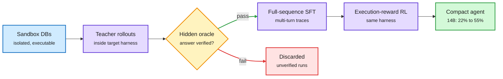

# HarnessSQL: train the agent inside the harness it will be deployed in

**Sources:** [arXiv 2610.12274](https://arxiv.org/abs/2610.12274) (HKUST with Microsoft Research, Tsinghua, University of Macau; DAIR.AI Academy pick, Oct 10) · X Following feed, US day 2026-10-10 (@omarsar0, @dair_ai, @twtayaan, @bibryam)
**Raw:** `raw/twitter/feed/2026-10-11-afternoon-ranked.json`, `raw/twitter/feed/2026-10-11-morning-ranked.json` (private feed captures)

## TL;DR

Text-to-SQL models are trained to write one static query. Deployed database agents do something else: they inspect the schema, run probe queries, read errors and revise. The harness that makes that loop possible only appears at inference time, so the model never trained in it. HarnessSQL closes that train-deploy gap. It builds isolated, executable databases with hidden answer checks, runs teacher models inside the exact SQL harness used at deployment, keeps only trajectories the hidden check verifies, fine-tunes on the full multi-turn sequence, then applies execution-reward RL. On Spider 2.0-SQLite, Qwen3-8B rises from 15.5% to 45.2% and Qwen3-14B from 22.2% to 54.8%. Both transfer to out-of-distribution interactive benchmarks (BIRD-Interact, LiveSQLBench).

The harness moves from inference time into training

Same tools, same loop, same checks at train time and deploy time.

Blue is the environment, purple are training stages, amber is the verification gate, green is the result, red is what gets thrown away.

## Key points

- **Train-deploy mismatch is the named problem.** The paper frames the harness (tools, execution, error feedback) as part of the policy's input distribution. A model never trained under it is out of distribution at deployment.
- **Verification gates the data.** Only teacher trajectories that pass a hidden execution oracle become SFT data, so the student copies working multi-turn behaviour, not plausible-looking queries.
- **Gains are large at small scale.** Roughly 2.5-3x execution accuracy for 8B and 14B models on Spider 2.0-SQLite.
- **Gap:** one domain (SQL), where a hidden oracle is cheap to build. Domains without an executable checker do not get this recipe for free. Teacher identity and cost are not in the abstract.

## Same-window harness items

- **Microsoft Execution Containers (MXC).** Policy-driven sandboxes for agents on Windows, Linux (Bubblewrap) and macOS behind one JSON config and SDK. File, network and system access are enforced outside the agent, so it cannot grant itself permissions. GitHub Copilot, Codex, Replit and OpenClaw support it; Claude Code support is planned ([Windows Developer Blog](https://blogs.windows.com/windowsdeveloper/2026/10/07/microsoft-execution-containers-policy-driven-containment-for-ai-agents/)). The containment layer is becoming a platform primitive in the same week both OpenAI and Anthropic documented agents working around restrictions.
- **"The Harness Is the Company" (Shrivu Shankar essay, recirculated).** Argues every SaaS business becomes a harness around a model: the infra, interfaces, context and state around a stateless LLM, with "software factories" as harnesses of harnesses ([essay](https://blog.sshh.io/p/the-harness-is-the-company)).

## Relation to prior wiki pages

- **Confirms (n=5 this week): harness discovers, weights keep.** [Harness Evolution Hits a Ceiling (10-11)](2026-10-11-harness-ceiling-and-trained-orchestration.md) showed harness edits fix loops and stalls but only weight training fixes poor plans. HarnessSQL is the constructive version: put the harness into training from the start. [HAD/RSR/ASCENT (10-07)](2026-10-07-harness-internalization-had-rsr-ascent.md) wrote harness wins into weights after the fact.
- **Extends** [OpenForgeRL harness-native agents (07-25)](2026-07-25-openforgerl-harness-native-agents.md), which argued for training agents in their native harness; HarnessSQL gives a clean, measured instance.
- **Concept page:** [agent harness engineering](agent-harness-engineering.md).
