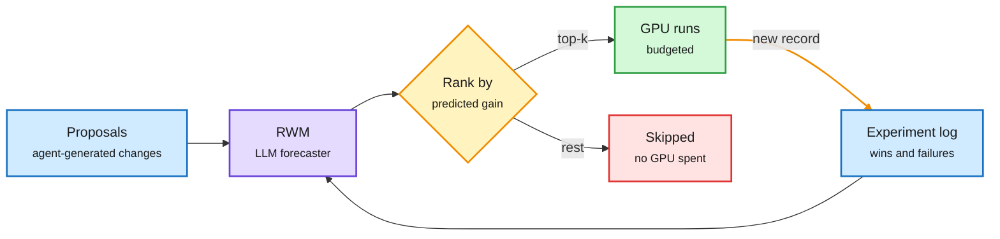

# Agent team costs, Research World Models, and AAArena

**Sources:** [The Decoder on Vals AI (10-11)](https://the-decoder.com/ai-agent-teams-waste-massive-tokens-for-barely-measurable-quality-gains-research-finds/) · [Vals AI report](https://www.vals.ai/blogs/multi-agent-vibe-code-bench) · [arXiv 2610.12235](https://arxiv.org/abs/2610.12235) (Amazon with UCSC, Emory, Penn State, UCSB) · [arXiv 2610.12341](https://arxiv.org/abs/2610.12341) (Tsinghua) · X Following feed via [@rohanpaul_ai](https://x.com/rohanpaul_ai/status/2109243398628708619)
**Raw:** `raw/rss/2026-10-11-the-decoder-ai-agent-teams-waste-massive-tokens-for-barely-measurab.md`, `raw/twitter/feed/2026-10-11-evening-210003-ranked.json`

## 1. Vals AI: agent teams on Vibe Code Bench

**TL;DR.** Vals AI ran GPT-6 Sol and Claude Opus 5.5 solo and as teams, at medium and maximum reasoning effort, on one benchmark (Vibe Code Bench, building apps). Four team-vs-solo comparisons. Teams cost **1.8x to 5.1x** more. Only **one** comparison was statistically significant: GPT-6 Sol at medium effort, +7.3 points. At maximum effort, teams gave neither model a real edge. The Decoder pairs it with the Opus 5.5 system card table: knowledge-base score 0.53 (1 agent) to 0.70 (10) to 0.74 (100); Lean proving 0.39 to 0.66 to 0.68. Gains land between 1 and 10 agents, then flatten. Noam Brown: 4 agents finish about 2x faster at about 2x cost. OpenAI's Eric Provencher calls the loss a "coordination tax".

- **Reading:** a team mostly substitutes for reasoning effort. When the solo agent already thinks at max effort, the team has little to add.
- **Gap:** one benchmark, two models, no per-cell cost breakdown in the article.

## 2. Language Models as AI Research World Models (Amazon)

**TL;DR.** Research agents propose experiments faster than anyone can pay to run them, so someone has to guess which runs deserve GPU time. The paper uses an LLM as a **research world model (RWM)**: given the setup, a proposed change and a log of past experiments, it predicts the change's gain before it runs. Tested on **2,653 real experiment records from 9 setups** (pretraining to inference). Feeding past records from the same setup lifted ranking correlation with the real outcome from **0.506 to 0.774** averaged over 5 setups. On OLMo3-100M, records plus *low* reasoning effort scored 0.892 vs 0.648 for *max* effort with no records. Experience also transfers across setups, and better forecasts lead to better experiment selection over several rounds.

The experiment log is worth more than a bigger thinker

History plus low effort beat max effort without history.

Blue is input, purple is the forecaster, amber is the ranking gate, green is spent compute, red is compute saved.

- **Relation:** extends [WMRL (09-10)](2026-09-10-wmrl-world-model-rl-research-agents.md), which replaced the real sandbox with a learned world model to make research-agent RL 3-4x cheaper. WMRL predicts outcomes to train agents; RWM predicts outcomes to *allocate* GPU hours. Same move as routing: a cheap predictor decides where the expensive compute goes.
- **Gap:** ranking correlation, not dollars saved end to end. Records come from curated setups; noisy real lab logs may be worse.

## 3. AAArena (Tsinghua): learning game bots from replays

A frozen-weight coding agent reads a game's rules, picks opponents, studies replays and rewrites its bot, across 12 games from Tsinghua's bot contest with **1,920 archived human programs** as rivals. Detailed replays beat win/loss-only feedback in all 3 games tested (a Pacman bot reached rank 1 vs rank 11). Tripling the match budget moved **none** of 4 stuck bots to rank 1. More compute did not fix games with complex rules, which echoes [Harness Evolution Hits a Ceiling (10-11)](2026-10-11-harness-ceiling-and-trained-orchestration.md): loop tweaks fix process failures, not weak strategy.

## How the three fit

All three ask the same cost question: when does more agent compute buy more result? Vals says teams rarely do, on one coding benchmark. [GitSwarm (10-12)](2026-10-12-gitswarm-compounding-inference.md) says they do when work persists as artifacts. RWM says the cheapest gain is to stop running bad experiments. AAArena says budget does not rescue a stuck strategy.

## Concept pages updated

[Multi-agent systems](multi-agent-systems.md) · [Test-time compute allocation](../inference-efficiency/test-time-compute-allocation.md)
