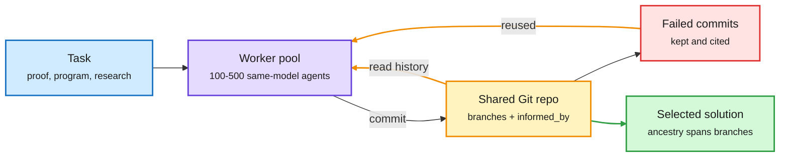

# GitSwarm: Decentralized Compounding Inference

**Sources:** [arXiv 2610.04862](https://arxiv.org/abs/2610.04862) (Meta Superintelligence Labs with Mila, CMU, Princeton, Columbia; DAIR.AI Academy pick, Oct 11) · X Following feed, US day 2026-10-11 ([@omarsar0](https://x.com/omarsar0/status/2109287161199812802), [@rohanpaul_ai](https://x.com/rohanpaul_ai/status/2109230760020574281)) · alphaxiv overview
**Raw:** `raw/twitter/feed/2026-10-11-evening-210003-ranked.json`, `raw/twitter/feed/2026-10-12-morning-ranked.json` (private feed captures)

## TL;DR

Most extra inference compute is spent on separate attempts: sample many answers, or let one agent keep going. When an attempt ends, its partial results and dead ends vanish, so the next attempt rediscovers them. The paper names the alternative **compounding inference**: organize test-time compute so intermediate work persists and later compute can inspect, extend, combine or challenge it. **GitSwarm** implements it with hundreds of identical asynchronous agents sharing one branchable Git repository. Every contribution is an atomic commit that declares, in an `informed_by` field, which earlier commits (on any branch) it builds on. There is no central planner; each worker chooses to explore, verify, refine or combine. With GPT-5.5 Codex workers it solved **all 30 IMOProofBench-Advanced problems in one run**, and on ProgramBench scored **79.4% vs 65.1%** for a single Codex agent told to keep going at a similar budget. Score rises with workers (73.1% at 100, 79.4% at 500). The accumulation evidence is the real result: later workers built on **94.7%** of published contributions, and **70.1% of failed research commits** were cited by later accepted work.

Every attempt becomes a commit the next agent can build on

No planner. Workers pick their own move and cite what they used, failures included.

Blue is the task, purple is the agent pool, amber is the shared-memory loop, red is failed work that still gets reused, green is the result.

## Key points

- **Two settings.** Verifiable tasks (proofs, program reconstruction) where score can be plotted against budget, and a sustained neural-architecture research run where agents pick experiments and share GPUs.
- **Decentralized at the level of ideas, not execution.** The harness still schedules, validates and runs work centrally. What is decentralized is the choice of what to work on.
- **The compounding claim is measured, not asserted.** The paper checks whether later agents actually reuse earlier artifacts (94.7%), whether solutions mix lines of work (selected solutions have ancestry across branches) and whether negative results matter (70.1% of failed research commits cited later).
- **Baseline is fair-ish.** The single-agent comparison is "keep going" prompting at similar budget, not a best-of-N or a routed agent.

## Gaps

- No dollar or wall-clock table for 500 frontier workers. The same-budget claim is in tokens; at frontier prices this is still a very large bill.
- All workers are one model. Whether a cheap-model swarm with a strong verifier compounds the same way is untested, and that is the cost question.
- Citation is self-declared by agents (`informed_by`), so "70% of failures reused" measures what agents say they used, not causal contribution.

## Relation to prior wiki pages

- **Direct successor to [Agora (09-17)](2026-09-17-agora-git-shared-memory-autoresearch.md)**, which also stored research as an append-only Git DAG of immutable commits and ran 13 workers for 12 days with no planner. Agora reported one long run; GitSwarm adds benchmarks with budget curves and the reuse statistics. Two papers in four weeks have now converged on Git as the substrate for multi-agent memory. With [GitHarness (10-05)](2026-10-05-githarness-and-harness-evolution-limits.md), which versioned a personal agent's harness in Git, this is **the third paper making the same architectural choice**: version control as agent memory.
- **Partially contradicts the swarm-skeptic line.** [Swarm scaling (10-06)](2026-10-06-swarm-scaling-speed-not-capability.md) summarized Toby Ord's estimate that swarms mostly buy wall-clock time (10x agents give 3-5x the gain of 10x tokens) and Anthropic's Opus 5.5 system card finding gains flatten past 10 agents. GitSwarm keeps improving from 100 to 500 workers. The difference is the substrate: those swarms communicate by messages; GitSwarm communicates through persistent artifacts. The Vals AI result the same day ([agent team costs](2026-10-12-agent-team-costs-and-research-world-models.md)) found teams 1.8-5.1x more expensive for one significant win in four.
- **Same economics as [Research World Models](2026-10-12-agent-team-costs-and-research-world-models.md) (10-12)**: both turn past compute, including failures, into a reusable asset.

## Concept pages updated

[Multi-agent systems](multi-agent-systems.md) · [Test-time compute allocation](../inference-efficiency/test-time-compute-allocation.md)
