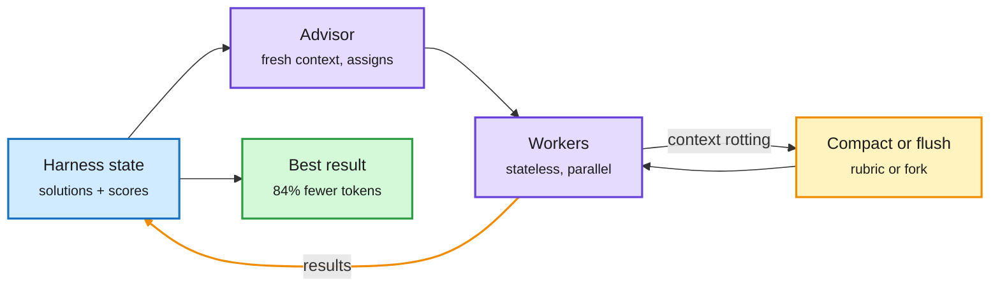

# Context is the cost: Stateless Language Agents, SelfCompact, Fork-and-Flush, ReHarness

**Sources:** HuggingFace Daily Papers 2026-10-12, Apple ML Research (lab watcher), The Decoder (RSS), X Following feed. Raw: `raw/huggingface/2026-10-12-stateless-language-agents-scaling-long-horizon-automated-res.md`, `raw/huggingface/2026-10-12-recurrent-harness-for-agentic-continual-learning.md`, `raw/labs/2026-10-13-103914-labs.md`, `raw/rss/2026-10-12-the-decoder-clearing-chat-history-helps-ai-agents-find-better-solut.md`.

## TL;DR

Four results on the same question: what should a long-running agent keep in its context window?

- **Stateless Language Agents (SLA)** ([arXiv 2610.07625](https://arxiv.org/abs/2610.07625), Stanford, CMU, UW, SambaNova, Berkeley). "Stateful search with stateless agents": no agent keeps its conversation between calls. The harness owns the research state (candidate solutions and measured scores) and builds a fresh, role-specific context for each call. A stateless Advisor reads harness-summarized evidence and assigns concrete experiments to parallel Workers. At budgets up to **1 billion tokens** on software engineering, kernel optimization and algorithm design, SLA gets the best final result on every task and matches the strongest kernel baseline's final score with **84% fewer tokens**; the Advisor uses under 0.6% of tokens. Also argues short-budget evaluations misjudge research systems because benchmarks saturate early.
- **SelfCompact** ([Apple ML Research](https://machinelearning.apple.com/research/self-compacting-language-agents), NeurIPS, with JHU). Let the model decide when to compact: a summarize tool plus a short rubric saying when to fire (a sub-task resolved, the trajectory converging) and when not to (mid-derivation, stuck). Neither works alone. Up to +18.1 points on math and +5-9 on agentic search over no summarization, at **30-70% lower per-question cost**, matching fixed-interval compaction at a fraction of the tokens. No fine-tuning.
- **Fork-and-Flush** (Microsoft and Dimitris Papailiopoulos; [The Decoder](https://the-decoder.com/clearing-chat-history-helps-ai-agents-find-better-solutions/), [thread](https://x.com/DimitrisPapail/status/2109661202733212136)). Long-running research agents fall into "idea basins": they keep polishing one family of ideas because their growing context anchors them. The fix: periodically fork into copies that share the workspace but start with empty chat history, then continue from the best. Up to 66% better results at equal compute, beating single runs and best-of-N on 12 of 13 long-horizon tasks.
- **ReHarness** ([arXiv 2610.12668](https://arxiv.org/abs/2610.12668)). For continual learning over a stream, revise *past* reflections using each new trajectory (backward flow through the textual harness state), not only write new ones. Beats raw-context, memory, reflection and prompt-optimization baselines on three benchmarks and three backbones.

The harness keeps the state; the agent starts fresh

Durable evidence lives outside the conversation, so context stays short and unanchored.

Blue is the durable state, purple is the agents, amber is the context reset, green is the result.

## Also in this cluster

- **Persistent memory null result** ([arXiv 2610.07782](https://arxiv.org/abs/2610.07782), UCLA et al., DAIR pick). A three-tier chain-of-agents cuts peak KV cache to 14.3 MiB per query (vs ~35 MiB single-pass/RAG) and latency 52-67 s to 29 s. The persistent tier that stores reasoning traces adds +0.368 MiB and +0.015 accuracy with a CI crossing zero. Decomposition pays; the memory tier does not on single-question benchmarks.
- **DUET** ([DAIR](https://academy.dair.ai/papers/duet-co-evolving-solver-and-grader-agents-2610.04087), arXiv 2610.04087, Microsoft). Update the LLM grader and the agent in alternating rounds. Finance Agent Benchmark 96.5% vs GEPA 94.4%; grader agreement on GDPval 68.4% to 78.5%. Training the grader with the solver frozen barely moves agreement. Same idea as Double Ratchet (10-13 Media Zone): the grader must evolve with the agent.
- **Agent Arena "Confirmed Success"** ([post](https://x.com/arena/status/2109711889026650203)). July's leader (Claude Fable 5) is now the top-20 average after 12 weeks; Kimi K3 matched it in 3 weeks at 89% lower cost per task, DeepSeek V4.1 Flash at 96% lower. Top 5 now confirm 94% of tasks done, up from 80%.
- **Continuous agent scoring** (Ken Huang, [Agentic AI](https://kenhuangus.substack.com/p/stop-scoring-agents-zero-at-90-done)). Android Bench 2.0's long-horizon tab: Claude Opus 5.5 on Claude Code at 32.7% pass but 84.7% completion, average 15.2 hours and $215 per task. Binary pass/fail erases 90%-done work; report a continuous completion score alongside it.

## Relation to prior wiki pages

- **Pattern (n=4 this week): context is a liability past a point.** [GitSwarm (10-12)](2026-10-12-gitswarm-compounding-inference.md) put durable state in a shared Git repo; [REMORY (10-10)](2026-10-10-context-compaction-remory-and-the-swarm.md) compacted context into learned soft tokens; today SLA and Fork-and-Flush reset context entirely while keeping the workspace, and SelfCompact lets the model choose when. The common rule: **state belongs in the harness or the workspace, not in the transcript.**
- **Cost link:** SLA's 84% token saving and SelfCompact's 30-70% cost cut are the agent-level version of the [kv-cache page](../inference-efficiency/kv-cache.md)'s session thread. Shorter contexts are fewer KV bytes per step.
- **Anthropic's self-replication post (10-13)** uses the same harness trick (Memento restarts fresh agents on the previous workspace). The method now appears in research automation, compaction and red-teaming.

## Related

[agent-harness-engineering](agent-harness-engineering.md) · [agent-memory](agent-memory.md) · [self-evolving-agents](self-evolving-agents.md) · [agent-benchmarks](agent-benchmarks.md)
