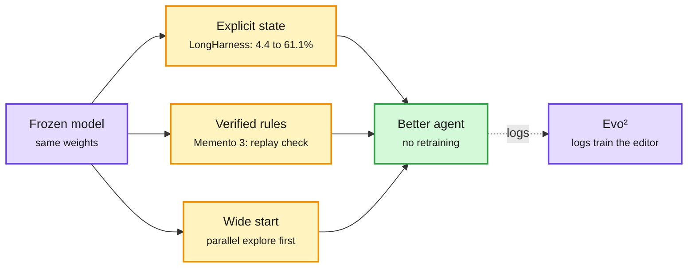

# The harness keeps beating the model, and agents outgrow human infrastructure

**Date:** 2026-10-14 · **Sources:** HuggingFace Daily Papers 10-13, DAIR picks via X, Kurate cs.AI/cs.LG, Anthropic Engineering, Pragmatic Engineer, NVIDIA Developer · **Raw:** [HF AgentSWE](../../raw/huggingface/2026-10-13-agentswe-can-coding-agents-build-the-agent-you-actually-want.md), [HF Initialization](../../raw/huggingface/2026-10-13-initialization-improves-llm-driven-discovery.md), [HF TerminalHorizon](../../raw/huggingface/2026-10-13-scaling-agentic-data-for-long-horizon-terminal-intelligence.md), [Gmail](../../raw/gmail/2026-10-14-newsletters.md) (private), X feed (private)

## TL;DR

The window carries the densest harness cluster this month. **LongHarness** ([arXiv 2610.13075](https://arxiv.org/abs/2610.13075), DAIR pick) stores evidence and open conclusions as explicit state when an agent searches a corpus far bigger than its window (100M+ tokens), so open conclusions drive retrieval and new evidence revises the conclusion that asked for it; GLM-5.3-Flash goes from 4.4% to 61.1% exact match on OfficeQA Pro V2, and the harness beats Claude Code by 12.1 points and Codex by 18.9. **Memento 3** ([arXiv 2610.11794](https://arxiv.org/abs/2610.11794)) has a frozen LLM write a natural-language rulebook of an environment, compile it into code that predicts the next state, and keep a version only if replaying it reproduces every observed transition; it clears all 25 public ARC-AGI-3 games at 44% of the human action count. **Evo²** ([arXiv 2610.13025](https://arxiv.org/abs/2610.13025), Google DeepMind) co-evolves harness and weights with one policy as Proposer and Reflector: 48.3% SWE-bench Verified and 82.1% Polyglot versus 41.0% and 62.6% for the best baselines. **Initialization Improves LLM-Driven Discovery** ([arXiv 2610.00707](https://arxiv.org/abs/2610.00707)) tests 12 harnesses on 5 discovery tasks, finds mode collapse (iterate diversity crashes) is the common failure, diversity tricks help inconsistently, and early-discovery quality predicts final success, so a parallel exploration phase before iterative optimization gives consistent gains. **AgentSWE** ([arXiv 2610.13361](https://arxiv.org/abs/2610.13361)) asks coding agents to build agents to a requirement and grades frozen submissions on held-out cases: none comes close, with overfitting to visible cases, hollow runtimes and unsupported claims of completion as recurring failures.

Explicit state, verified updates, wide starts

Each harness result adds one structural rule around a model that does not change.

Purple is a model, amber is a harness rule, green is the improved agent.

## Also in the cluster

- **TerminalHorizon** ([arXiv 2610.13166](https://arxiv.org/abs/2610.13166)): synthesizes 1.5K long-horizon terminal environments from real professional work, using independent execution to find work the environment builder silently pre-completed; SFT of Qwen3.5-27B gains on all 12 benchmarks.
- **CRBugBench** ([arXiv 2610.13668](https://arxiv.org/abs/2610.13668)): 1,000 open-source plus 800 proprietary review tasks; the best review agent (Opus 5 with Copilot CLI) catches 71.9% of bugs in its top-5 comments, up from 47.7% five months earlier, but drops sharply on proprietary repos. Exploration-nudging prompts add up to 5.8% for 10% more cost.
- **OSVerify** (Stanford, [site](https://osverify.github.io/)): one-sided verification that proposes errors and then validates them, instead of judging whole solutions. Refereed 11 OpenAI math preprints (5 major, 13 minor issues, expert-confirmed); cuts invalid candidates needing expert review by 46% vs voting (57% with an RL-trained validator).
- **Kurate this week:** HarnessTTT (test-time harness optimization for discovery, [2610.17370](https://arxiv.org/abs/2610.17370)) and Harness Compilation (which decisions a small VLM should keep, [2610.11231](https://arxiv.org/abs/2610.11231)).
- **Siemens EDA on NVIDIA NeMo Gym:** verifier diagnostics drove skill and MCP tool-description edits; composite score 55% to ~95%, agent turns 155 to 53, output tokens ~81K to ~29K.
- **Cohere's agent teams:** see [routing page](../ai-routing/2026-10-14-session-routing-arena-max-cohere-teams.md).

## Agents outgrow human-scale infrastructure

- **Anthropic replaced git (Scion):** merged changes rose from ~2,500/day in May to 30,000+/day in September; main-branch history is ~100GB and CI does ~25M checkouts/day. Scion moves history, blame and merges server-side and makes commit cost scale with the change, not the repo ([post](https://www.anthropic.com/engineering/redesigning-source-control)).
- **Uber:** CI jobs more than doubled in 12 months ("code red"); simple checks moved into the agent's inner loop; code review is now the main bottleneck; a Model Gateway with per-user spend tracking plus a CostCheck plugin cut token costs ~50% ([Pragmatic Engineer](https://newsletter.pragmaticengineer.com/p/ubers-ai-infra-from-the-inside)).

## How it relates to prior wiki pages

- **Confirms the harness-ceiling thread** on [agent harness engineering](agent-harness-engineering.md): [HarnessSQL (10-11)](2026-10-11-harnesssql-harness-native-training.md) doubled a score by training inside the harness; [stateless agents (10-13)](2026-10-13-stateless-agents-self-compaction-and-idea-basins.md) showed the transcript itself is the cost. LongHarness is the same lesson for retrieval: make state explicit instead of letting it pile up in the chat.
- **Initialization vs idea basins:** the 10-13 "idea basins" result found agents converge to a few attractor solutions; today's Initialization paper names the same mode collapse and finds the fix is a wide start, not mid-run diversity pressure.
- **AgentSWE and CRBugBench extend the measurement worry** from [SWE-TaskFlow (10-13)](2026-10-13-stateless-agents-self-compaction-and-idea-basins.md): visible-case success overstates delivered quality.

## Related

[agent-harness-engineering.md](agent-harness-engineering.md) · [self-evolving-agents.md](self-evolving-agents.md) · [agent-benchmarks.md](agent-benchmarks.md) · [multi-agent-systems.md](multi-agent-systems.md)
