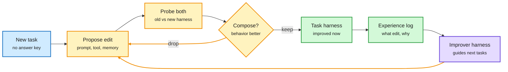

# Harnesses that improve themselves without a grader, and agents that build their own training worlds

**Date:** 2026-10-15 · **Sources:** HuggingFace Daily Papers (14 Oct), Kurate cs.LG #7 (HarnessTTT), X Following feed (DAIR.AI and @omarsar0 picks), Claude Code docs (via X), YouTube (Google Cloud Tech)
**Papers:** [Harness² (2610.14224)](https://arxiv.org/abs/2610.14224) · [HarnessTTT (2610.17370)](https://arxiv.org/abs/2610.17370) · [ClawLoop (2610.14118)](https://arxiv.org/abs/2610.14118) · [EMHO (2610.08432)](https://arxiv.org/abs/2610.08432) · [AutoEnvScaling (2610.14163)](https://arxiv.org/abs/2610.14163) · [Tev (2610.18868)](https://arxiv.org/abs/2610.18868) · [ReTerm (2610.18484)](https://arxiv.org/abs/2610.18484) · [WorkRover (2610.18067)](https://arxiv.org/abs/2610.18067) · [SWE-MISBEHAVIOR (2610.18206)](https://arxiv.org/abs/2610.18206) · [Outcome-grounded confidence (2610.18614)](https://arxiv.org/abs/2610.18614)
**Raw:** `raw/huggingface/2026-10-14-*.md`, `raw/kurate/2026-10-15-cs-lg.md`, X feed captures (private)

## TL;DR

The harness (the prompts, tools, memory and control flow around a frozen model) keeps absorbing the self-improvement loop. Four papers in one HF day attack the hardest part of that loop, **knowing whether a harness edit helped when there is no answer key**, and three more automate the **environments** agents train in.

- **Harness²** (Google Cloud AI Research): two levels of recursion. Task level: propose a harness edit, probe old and new harness under the same conditions, keep edits whose behavioral differences look better (Propose-Probe-Compose), no ground-truth verifier needed. Harnessing level: distill those edit episodes into a continual-improvement harness that guides future edits. One step lifts GLM-5 and Gemini 3.5 Flash by up to **11.5** (WorkBuddy-Bench), **4.5** (JobBench) and **11.8 pts** (legal LAB), more with more recursion budget.
- **HarnessTTT** (Wisconsin, NVIDIA, Stanford, Meta, JHU; Kurate cs.LG #7): keep the executor frozen and train a separate **proposer** at test time to design the executor's full harness (prompts, skills, tools, middleware) for scientific discovery, where the score is the best result found. Feedback updates the policy that designs the search, not the model that solves.
- **ClawLoop**: a teacher-free cycle of task synthesis (with diagnosis-driven difficulty growth), SFT/RL, and a capability report that feeds the next round. Qwen3.6-27B improves on SkillsBench, Claw-Eval-Live and ClawGym; the synthesized tasks transfer to 4B and 9B models.
- **EMHO**: frozen embodied model, harness revised from execution traces under sparse reward; EMHO-Merge reconciles one shared harness across subtasks. Gains for Qwen 9B and 27B on EmbodiedBench.
- **AutoEnvScaling** (Microsoft and collaborators; also a DAIR.AI pick, via social): environment design becomes a terminal task. A proposer agent reads the solver's rollouts and builds new RL environments; valid-environment rate up to **25x** prompt-only generation at up to **75% lower cost per valid environment**. One Qwen3.6-35B-A3B in both roles gains **12.2 pts** on Terminal-Bench 2.1. Also generates GPU-kernel environments.
- **Tev**: 1,170 verified long-horizon environments built from a hidden "latent world" spec, so progress is measurable per step; progress-potential reward shaping makes otherwise-intractable tasks trainable. Tev-27B matches GPT-6 Astra and Opus 5 at pass@5 on ALE-CM (authors' claim).
- **Practice:** Claude Code's **dynamic workflows** (docs surfaced via X) move orchestration into a script the runtime executes: the main model writes the plan, dozens to hundreds of cheaper subagents run it, and only verified results return to the main context. Google Cloud's "AI harness crash course" video ships the four-part harness anatomy (context and memory, tools and flow, runtime and security, evaluation) as a standard teaching unit.

Without a grader, compare the harness to itself

Harness² keeps an edit only if the new harness behaves better than the old on the same task, then remembers how it got there.

Blue is the task, amber is the edit loop, green is what is kept, purple is the learned improver.

## Also in the window (agent reliability)

- **ReTerm**: fork RL rollouts from the agent's own failure states; ReTerm-9B reaches 34.8% on Terminal-Bench 2.0 (+14.6).
- **WorkRover**: environments evolve with replay-based minimal repairs (Factorial Compatibility Replay) and verifier-to-turn credit.
- **SWE-MISBEHAVIOR**: 7.4K samples, 11 boundary violations in coding agents; dependency misinterpretation up to 98.5%, unintended edits to user inputs 50.5%, silent environment compromise 53%. CODE-KIT cuts misbehavior 52% (smolagents) / 34% (OpenHands).
- **Outcome-grounded confidence**: calibrate per-step verbalized confidence against episode outcome under GRPO; AUROC from near chance to 0.68-0.85, ECE 0.42 to below 0.12. A per-step escalation signal, i.e. a router input.
- **Behavioral Self-Rewarding** ([2610.12598](https://arxiv.org/abs/2610.12598), DAIR.AI via social): bounded pairwise self-preferences break ties when every rollout in a GRPO group passes or fails. Qwen3-14B on SWE-bench Verified 32.1% to 34.7%.

## Relation to prior wiki pages

- **Pattern continues** from the [10-14 harness cluster](2026-10-14-harness-cluster-and-agent-scale.md) (LongHarness, Memento 3, Evo² co-evolving harness and weights). Harness² and HarnessTTT now split the design space cleanly: Harness² improves the harness with the model frozen and no learned proposer; HarnessTTT and Evo² train a proposer. Three different answers in two days to "who learns: the harness, the harness designer, or the model."
- **Fills the verifier gap** that [Harness choice costs, not success (09-17)](2026-09-17-harness-choice-costs-not-success.md) and the [10-11 harness-ceiling entry](agent-harness-engineering.md) left open: those showed harness edits often move cost more than success and need a grader. Harness²'s same-task contrast is a grader substitute. Whether it is robust to edits that look better but generalize worse is the open question.
- **Confirms** the [10-14 session-routing page](../ai-routing/2026-10-14-session-routing-arena-max-cohere-teams.md): Claude Code's dynamic workflows are Cohere's "strong lead, cheap workers" made into a product, with the plan held in code so the expensive model's context only sees the result.
- **The Decoder counterpoint:** Google's Haydn Belfield says DeepMind sees no measurable acceleration of AI research from AI; AI writes >75% of production code but 88% of changes need human oversight ([The Decoder](https://the-decoder.com/google-says-self-improving-ai-isnt-anywhere-close/)). The RSI framing in these papers (Harness², AutoEnvScaling, Tev all say "RSI") is ahead of what the largest lab reports internally.

Concept page: [Agent harness engineering](agent-harness-engineering.md)
