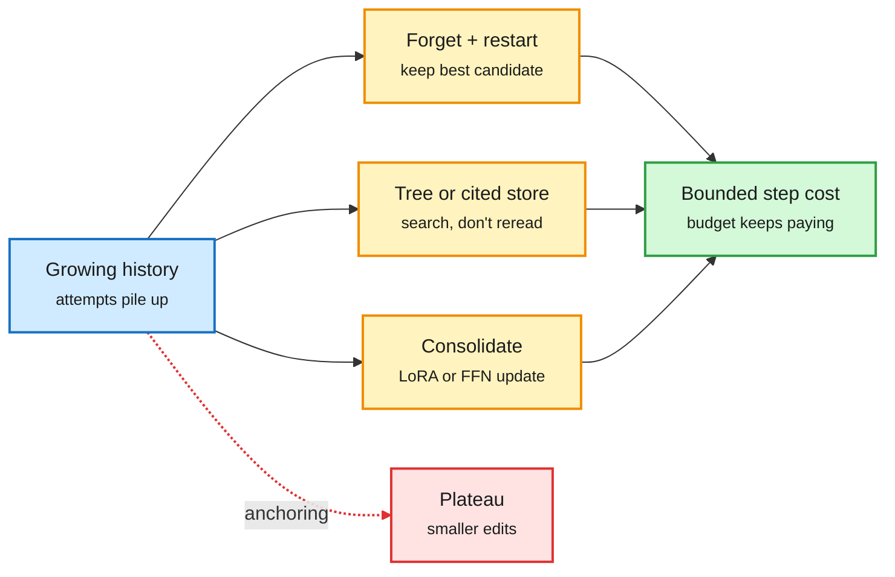

# Agent context: forget on purpose, search a tree, cite a store

**Date:** 2026-10-16 · **Source:** X following feed (@omarsar0, @dair_ai, @hardmaru, @SakanaAILabs) + HuggingFace Daily Papers
**Papers:** [Scaling Discovery Requires Forgetting (UC Berkeley), arXiv 2610.20563](https://arxiv.org/abs/2610.20563) · [TreeFlex (Meta), arXiv 2610.20334](https://arxiv.org/abs/2610.20334) · [ScaleMAS, arXiv 2610.16120](https://arxiv.org/abs/2610.16120) · [The Agentic Scientist (Sakana), arXiv 2610.18933](https://arxiv.org/abs/2610.18933) · [Cortex, arXiv 2610.20399](https://arxiv.org/abs/2610.20399) · [Doc2Harness, arXiv 2610.20344](https://arxiv.org/abs/2610.20344)
**Raw:** `raw/twitter/feed/2026-10-15-evening-211221-ranked.json`, `raw/twitter/feed/2026-10-16-morning-ranked.json`, `raw/huggingface/2026-10-15-*.md`

## TL;DR

Five papers in one window treat accumulated agent context as the problem.

- **Scaling Discovery Requires Forgetting.** Research agents with scored verifiers plateau whether you scale one agent longer, run agents in parallel, or let them share candidates. Each agent anchors on its own past attempts and makes smaller edits. Fix: **periodically delete every session and the candidate history, restart from the best candidate so far.** Up to **+15% over parallel agents and +39% over a single agent** at the same budget, on heuristic programming, **kernel optimization** and model training tasks.
- **TreeFlex.** The harness saves each intermediate state as a tree node with a summary. As "Reflection" the model reads summaries and picks where to resume, branch, verify or stop; as "Execution" it gets only the path to that node. Trained jointly with tree-aware GRPO. 4B: 48.8% vs 41.5% flat ReAct on deep research; 9B: 54.9% vs 43.3% for FoldAgent on SWE-bench Verified.
- **ScaleMAS.** Agents never message each other directly; they publish citable messages, search (top-k by relevance and citation count) and visit by address. Each agent's reading stays bounded, so it scales to 128 agents at lower compute and survives agent loss.
- **The Agentic Scientist (AI Scientist v3).** Parallel coding-agent workers sharing memory and distilled conclusions, plus isolated "evidence generation" agents that run ablations. ALIFE 2026 oral from a co-discovered learning rule.
- **Cortex.** Distils context gains into mergeable low-rank or FFN updates. After 50 sequential edits on a 14B model it keeps 88.9% of the context gain and 99.8% of non-target performance.
- **Doc2Harness** (HF #4, 98 upvotes) benchmarks building a harness itself: best model (GPT-6 Astra) passes 53.05% of 328 tests, worst 27.44%; failures cluster where cross-cutting features span modules.

Three ways out of the growing context

Delete it, index it, or compile it into weights; all three keep per-step reading bounded.

Blue is the accumulated context, amber is the three strategies, green is the bounded cost, red is the plateau they avoid.

## Relation to prior wiki pages

- **Contradiction with the self-evolving-agents thread.** Harness² and Evo² (10-14/15) improve by *keeping and logging* edit history so future edits get better. Forgetting argues that history is exactly what stalls discovery. The two may be compatible (Harness² keeps *how* edits were made, Forgetting discards *what was tried*), but no paper has tested both on one task. See [self-evolving agents](self-evolving-agents.md).
- **N-of-a-kind:** TreeFlex, ScaleMAS and the Agentic Scientist (10-15 Media Zone) plus Forgetting make four papers in two days that replace a flat shared context with a bounded read. See [agent memory](agent-memory.md), [multi-agent systems](multi-agent-systems.md).
- **Kernel optimization is one of Forgetting's four tasks**, which ties it to the GPU-kernel agent line on the [gpu-kernels page](../hardware/gpu-kernels.md).
- Doc2Harness is the benchmark the [harness engineering page](agent-harness-engineering.md) has lacked: it scores the harness, not the model.
