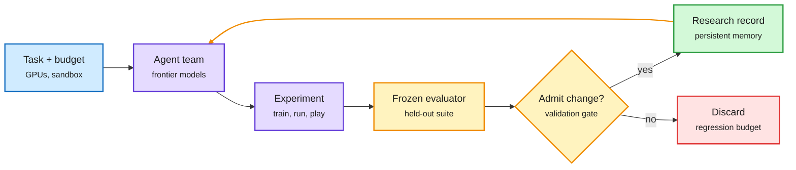

# Agents that improve agents: Athanor, Terminal-RSI, Harness RSI, and a Minecraft run

**TL;DR.** The 10-16 HF list carried a cluster of "measurable recursive self-improvement" papers. **Athanor**: four Claude Opus 5.5 agents, each on an 8-GPU node with no research advice and no teacher models, post-trained Qwen3-4B-Base in 104 hours from 15.9 to 67.3 on a six-task dev suite and 9.2 to 48.2 on a hidden held-out suite, edging the official Qwen3-4B-Instruct-2507 (66.5 / 47.9). They got there by recombining known methods: SFT on public reasoning data, RL with one agent's rollout tweak, weight merges across agents, and rounds of self-distillation. **Terminal-RSI** (also posted to X by an author) alternates rewriting verified trajectories with critic-inheriting policy refinement over five stages, taking a Qwen3.8-27B base to 86.52% on Terminal-Bench 2.1. **Self-Evolving Agent Harness** is a 66-page formal treatment of harness self-modification (prompts, memory, tools, code) with fixed weights, including a PAC-style admission rule using fresh validation data. **Gemini 4 Argon in Minecraft** (Google DeepMind, HF + social): four agents beat the Ender Dragon from a random seed in 27h14m, writing 2,783 programs and dying 605 times, with no assigned roles. **AutoSFT** finds a single data-research agent loses its context mid-search and only adjusts proportions; a meta-agent that separates execution from analysis adds +6.5 IFEval.

The loop is the product, and the model is one box in it

Every paper here keeps weights or methods fixed and improves what wraps them.

Blue is the setup, purple the agents and experiments, amber the evaluation gate, green kept knowledge, red rejected changes.

## Relation to prior wiki pages

- **Confirms the 10-16 "agents get better by forgetting" thread** (an agent that drops history and restarts from the best candidate beat parallel agents by up to 15%). AutoSFT is the same lesson from the failure side: the single agent's context filled up and it lost the search.
- **Frozen evaluators are now the common safety rail.** Athanor's services (frozen eval, decontaminated data, hidden held-out suite) and Harness RSI's fresh-validation admission rule both assume the agent can game anything it can see. That matches GRAFT (10-16, using a weak reward-hack monitor to confine hacking), and today's verifier-hardening paper (an automated hacker-fixer loop that repairs exploitable agent-environment verifiers).
- **Persistence is the capability.** omarsar0 on X noted the Minecraft agents self-organized with no roles; Athanor's agents ran 104 hours. The [agent-harness-engineering](agent-harness-engineering.md) page has tracked harness quality as the main lever since 08-13; these runs show a frontier model holding a plan for a day or more.
- **Efficiency angle.** Athanor matches an official instruct model using a 4B base and public data. Datadog (via Ken Huang, 10-16) matched frontier models on incident triage at 3-8x lower cost with a specialized model. Both point to cheap specialized post-training as the thing agents do best.

## Gaps

- Athanor: one campaign, one base model; no variance across runs; compute cost of 32 GPUs × 104 h not compared to the human recipe.
- Minecraft: one seed, Easy difficulty, one run.
- Harness RSI: theory and a survey, no new empirical result.

Concept pages: [self-evolving-agents](self-evolving-agents.md), [agent-harness-engineering](agent-harness-engineering.md).
