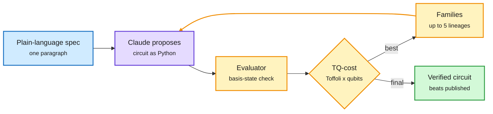

# Claude designs quantum circuits and recovers the NIST curve seeds

**TL;DR.** Two Anthropic research posts from 10-16 show evaluator-guided search by a frontier model producing checkable results. **Quantum circuits** ([post](https://www.anthropic.com/research/designing-efficient-quantum-circuits), arXiv [2610.22367](https://arxiv.org/abs/2610.22367); Andi Gu with Alek Kemeny at Anthropic, Susanne Yelin and Mikhail Lukin at Harvard/QuEra): Claude Mythos 5 proposes circuit-generating Python programs inside an OpenEvolve loop; an independent evaluator checks correctness on computational basis states (cheap because these reversible circuits never create superpositions) and scores Toffoli gates and peak qubits. On 7 of 8 tasks (chemistry, optimization, simulation, number theory) the circuits cut both counts versus the best published designs, sometimes by an order of magnitude; on the 8th it found a new reversible architecture for prime-field modular inversion that makes the divsteps algorithm practical. A recurring trick it discovered: replace conditional arithmetic with conditional routing, so an expensive kernel appears once (halving the schoolbook Toffoli count). DAIR Academy featured it the same day (via X). **ECDSA seeds** ([post](https://www.anthropic.com/research/ecdsa-curve-origins)): in under half an hour, an internal Claude model showed the unexplained NSA-supplied seeds for NIST P-192 through P-521 came from C's `lrand48` generator seeded with Unix timestamps from May 1997 to April 1998, recovered via a bit-pattern scan and an LLL lattice attack on the truncated LCG. It also explained six base points (FreeLIP's RNG). This lowers, not raises, backdoor suspicion.

The evaluator, not the model, makes the result trustworthy

Every reported gain is a circuit the checker verified.

Blue is the spec, purple the model, amber the search-and-check loop, green the verified output.

## Relation to prior wiki pages

- Same evaluator-in-the-loop shape as AlphaEvolve-style work and today's Athanor (agents post-training under a frozen evaluator). The common rule: the search can be as creative as it likes because acceptance is mechanical.
- Contrast with "LLMs extend known research but do not create new directions" (Kurate cs.AI #19 this week). The circuit search mostly recombined known families, but the divsteps architecture is a genuinely new structure. Both claims can hold at once.
- Efficiency lens: fewer Toffoli gates and qubits is resource compression for quantum hardware, the same objective as quantization for GPUs.

Concept page: [self-evolving-agents](self-evolving-agents.md).
