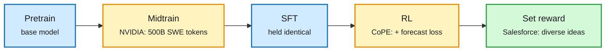

# Three agent-training recipes: NVIDIA midtraining, CoPE forecasting, set-level ideation RL

**TL;DR.** Three papers from the 10-17 X feed, each changing one stage of how agents are trained. **NVIDIA** adds one midtraining stage for agentic coding and keeps SFT fixed. **CoPE** (UIUC, UCSD, Meta) adds one auxiliary loss to GRPO and doubles sample efficiency. **Salesforce** trains an 8B model to write a *set* of diverse research ideas with a set-level reward.

Each recipe touches exactly one stage

Midtraining before SFT, an auxiliary loss inside RL, a set reward at the end.

Blue stages are unchanged, amber stages are where the papers intervene, green is the output objective.

## NVIDIA: priming base models for agentic post-training (2610.22019)

- One midtraining stage between pretraining and post-training: **256K context, 500B tokens** of natural software-engineering data (packed repositories, pull requests, commit histories, build logs) plus a small share of agent traces. SFT held identical.
- Nemotron 3.5 Lightning: SWE-bench Multilingual 55.8 → 62.8, Verified 60.7 → 64.5, Pro 32.0 → 35.5. Nemotron 3.5 Super: DeepSWE 11.7 → 15.7.
- **Base-model proxy metrics did not predict post-training results**, so every data choice was scored with short fixed SFT runs. Recipe and ablations are public.
- Relation: same lesson as [JevAgentHarness (10-18)](../ai-routing/2026-10-18-jevagentharness-decision-model-delegation.md), where isolated accuracy misranked decision models by up to 57.5 points of task success. Offline proxies keep failing to predict behavior inside an agent loop.

## CoPE: co-evolving acting and forecasting (2610.20597)

- Agentic RL gives one terminal reward, so most of a long rollout is unused. CoPE adds a loss that, on **successful** rollouts only, trains the same backbone to forecast the next K actions from each history.
- Up to **2.0x sample efficiency** over GRPO (ScienceWorld), 1.6x on AppWorld; +5.0 points on ALFWorld, +12.5 on WebShop, +8.0 on ScienceWorld. No extra model, no inference cost: the policy still acts one step at a time.
- Relation: a cheaper alternative to process reward models for dense credit. Same goal as Hy-Memory's chunk-level attributed rewards (10-17).

## Training reasoning models to generate diverse scientific ideas (2610.22324)

- 8B model writes K idea cards in one generation; each idea's quality is weighted by its distance from earlier ideas in the set.
- Higher "creative utility" (quality × diversity) than Claude Opus 4.8 and GPT-6 Astra on a contamination-free benchmark; a four-expert pilot rated sets as promising as Opus 4.8's; proof-of-concept success@k comparable.
- Relation: the diversity counterpart to [Scaling Discovery Requires Forgetting (10-16)](2026-10-16-forgetting-trees-and-cited-stores.md), which found research agents plateau because they anchor on their own history.

## Gaps

NVIDIA reports only its own Nemotron family. CoPE tests on research benchmarks up to AppWorld. The ideation human study has four raters.

Sources: [NVIDIA 2610.22019](https://arxiv.org/abs/2610.22019) · [CoPE 2610.20597](https://arxiv.org/abs/2610.20597) · [project page](https://ulab-uiuc.github.io/CoPE/) · [Salesforce 2610.22324](https://arxiv.org/abs/2610.22324)
