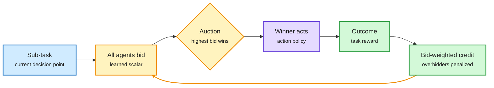

# Market-based post-training (MPT): agents bid for each step, no coordinator

**TL;DR.** A Harvard and MIT team (including Yilun Du) trains a swarm of agents with no central orchestrator. Each agent learns two policies: an **action policy** (what to do) and a **bidding policy** (a scalar saying how willing and able it is to take this step). At each decision point the highest bidder acts. Credit flows back in proportion to bids, so an agent that bids high and fails takes the largest penalty. Over training, agents learn to bid high where they are good and low elsewhere. Tested on embodied crafting, multi-robot navigation and deep research.

Orchestration becomes a learned price, not a fixed pipeline

Bids decide who acts, and the same bids decide who gets the training credit.

Blue is the task, amber is the bidding market, purple is the acting agent, green is reward and credit.

## Key findings

- Gains over monolithic post-training; with the same action policies, learned self-orchestration beats alternative coordination strategies.
- Both action and bidding benefit from learning; learned bids give better action-training signal.
- Swarms trained with 3 agents scale to more agents at inference and *improve*; larger populations lose less under agent dropout (the X summary cites up to 90% node loss, not verified in the abstract).
- Trained swarms adapt faster to related tasks.

## Relation to prior wiki pages

- **Learned version of Google DeepMind's agentic auctions (10-16)**, which showed first-price auctions among bidding agents approach efficiency when near-peers compete ([llm-routing](../ai-routing/llm-routing.md)). DeepMind analysed the auction; MPT trains the bidders.
- **A routing decision by another name.** The bid is a per-step routing score emitted by each candidate rather than by a central router. Compare [JevAgentHarness (10-18)](../ai-routing/2026-10-18-jevagentharness-decision-model-delegation.md), which routes decisions with a fitted confidence threshold.
- Tension with [multi-agent-systems](multi-agent-systems.md) results that teams add little once a solo agent runs at max effort (Vals AI, 10-12). MPT's comparison is to fixed pipelines, not to one strong agent.

## Gaps

No cost accounting: every agent computes a bid every step. Benchmarks are research environments, not coding or production tasks.

Source: [arXiv 2610.22322](https://arxiv.org/abs/2610.22322) · [X thread (Chinese)](https://x.com/snwiki238337/status/2111339705774317898)
