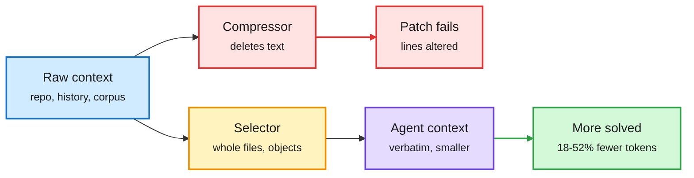

# What the agent sees decides what it costs: TokenEconomizer, CQ2-CARE, CarryOn, Librarian Agents

**Sources:** HuggingFace daily papers 2026-10-19: [TokenEconomizer, 2610.22732](https://arxiv.org/abs/2610.22732); [Skip the Compressor (CQ2-CARE), 2610.21073](https://arxiv.org/abs/2610.21073); [Pack Light, CarryOn, 2610.18784](https://arxiv.org/abs/2610.18784); [Librarian Agents, 2610.22273](https://arxiv.org/abs/2610.22273). Raw: `raw/huggingface/2026-10-19-*` (see each slug).

## TL;DR

Four papers on one question: which tokens should an agent's context hold?

- **TokenEconomizer** runs coding agents over *sequences* of real tasks in the same repo and finds recurring, environment-specific token waste. An external controller decides which micro-skills to inject, which persistently unused tools to prune, and when to break unproductive failure loops. **18.4-30.9% fewer tokens** with comparable success across Claude Code, Codex and Copilot CLI; 6.4-21.2% on web dev and security audits.
- **Skip the Compressor (CQ2-CARE)**: at an equal token budget, picking whole files verbatim beats prompt compressors by **6.3 points** and retrievers by **9.3-12.7 points** on 300 SWE-rebench issues (43.7% with GPT-5.6, 46.7% with Opus 5). Compressors keep the right files but alter the text, so patches fail to apply.
- **CarryOn** organizes long-horizon context around reusable task objects ("carriers") instead of history, updating them at each fold. **+5.8% on OSWorld 2.0 with 51.9% fewer tokens; +7.0% on BrowseComp-Plus with 22.9% fewer.**
- **Librarian Agents** trains a builder agent with RL to turn a raw corpus into a filesystem workspace that a later answering agent uses. **+33 points on BrowseComp-Plus** over the best retrieval baseline; +31 points zero-shot on BRIGHT; build cost amortizes over many queries.

Spend the budget on choosing, not on squeezing

All four move effort from compressing text to deciding what enters context.

Red is the compression path that breaks exact code, amber is selection, green is the payoff.

## How this relates to prior wiki pages

- **Pattern now n=5 on "selection beats compression":** Memorilla (10-19, 16 memory tokens beat full context on FactKG), Meta's Thin Orchestrator (today, isolate each specialist's context), CQ2-CARE, CarryOn and Librarian Agents. The common claim: deciding what enters context dominates shrinking what is already there.
- **Tension with Memorilla:** Memorilla compresses to soft tokens and wins on fact verification; CQ2-CARE shows compression loses when the task needs exact text. The 10-19 Looking Ahead predicted Memorilla would break on exact recall; CQ2-CARE is indirect evidence for that prediction, on code.
- **TokenEconomizer extends the 10-19 token audit of security agents** (which found 60.4% of tokens go to understanding code) from measurement to control. See [agent-harness-engineering](agent-harness-engineering.md) and [agent-memory](agent-memory.md).

## Gaps

- TokenEconomizer and CarryOn report averages; variance across repos and the cost of the controller itself are not in the abstracts.
- Librarian's upfront build cost vs query volume break-even is not quantified in the abstract.
