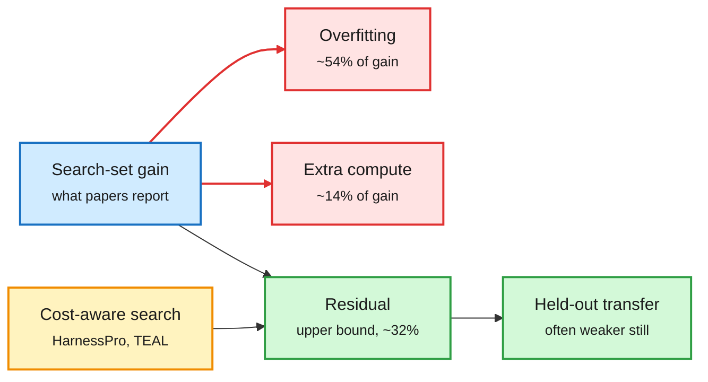

# The harness-evolution wave, and its first audit (Harness-Delta Attribution, HarnessPro, Self-HPO, Agent S4 and seven more)

**Sources:** HuggingFace daily papers 2026-10-20/21 (eleven papers in two days):
[Harness-Delta Attribution, 2610.22466](https://arxiv.org/abs/2610.22466);
[HarnessPro, 2610.26770](https://arxiv.org/abs/2610.26770) ([code](https://github.com/pzs19/HarnessPro));
[Self-HPO, 2610.22791](https://arxiv.org/abs/2610.22791);
[Evolving Agent Interfaces (Agent S4), 2610.28601](https://arxiv.org/abs/2610.28601);
[HarnessAdapt-RL, "Training the Whole Agent", 2610.28069](https://arxiv.org/abs/2610.28069);
[HERA, 2610.06563](https://arxiv.org/abs/2610.06563);
[CoEvo-RSI, 2610.25078](https://arxiv.org/abs/2610.25078);
[RiseHarness, 2610.27435](https://arxiv.org/abs/2610.27435);
[HarnessRL, 2610.26426](https://arxiv.org/abs/2610.26426);
[RSIFlow, 2610.21791](https://arxiv.org/abs/2610.21791);
[TEAL unsupervised tool evolution, 2610.27327](https://arxiv.org/abs/2610.27327);
[Épi, 2610.24944](https://arxiv.org/abs/2610.24944).
Via the X feed (not on HF this window): [Object-Oriented Harness, 2610.28380](https://arxiv.org/abs/2610.28380) (Google Cloud AI Research); [Are Self-Evolving Agents Continual Learners?, 2610.25858](https://arxiv.org/abs/2610.25858).
Raw: `raw/huggingface/2026-10-2[01]-*` matching slugs.

## TL;DR

In two days HuggingFace carried more than ten papers that let an agent rewrite its own harness (the prompts, tools, skills, hooks and orchestration code around a fixed model). The first rigorous audit landed in the same batch.

- **Harness-Delta Attribution (HDA)** splits a harness-evolution gain into overfitting to the search set, extra test-time compute, and a residual. Across 11 executor models and 3 evolution frameworks, in the 21 settings with significant search-set gains, **overfitting explains 54% and test-time scaling 14% of the gain on average**; together they exceed half in 14 of 21. Search-set gains often fail to transfer to held-out tasks, and validation signals do not prevent overfitting.
- **HarnessPro** evolves harnesses with LLM-generated tests (no ground truth) and returns three Pareto points (lite/medium/heavy). Heavy mode: **+2.0 points pass rate and 26.1% lower per-task cost** than RHO with GPT-5.5 + Codex on Terminal-Bench 2, SWE-Bench Pro, ProgramBench.
- **Agent S4 / Evolving Agent Interfaces**: a meta-agent builds new interfaces (e.g. "write one line of code instead of typing cells") from unlabeled trajectories. Qwen3.8-27B reaches **21.3% on OSWorld V2, 3.8x the same model with fixed interfaces, above GPT-5.5 (13.0%) and Opus 4.8 (20.6%) at about 4.3% and 1.5% of their cost.**
- **Co-evolving harness and weights:** Self-HPO (policy proposes harness edits, then RL under the chosen harness; Qwen3.5-35B-A3B 57.8% to 64.8% resolve), HarnessAdapt-RL (+9.8/12.6/6.4 pass@1 over GRPO on SWE-bench Verified/Multilingual/Pro with a 9B model; removing evolved tools at deployment costs up to 7.7 points), CoEvo-RSI (fixes "brain-body mismatch" by choosing or merging checkpoints to fit the evolved harness; Qwen3.5-9B beats DeepSeek-V4-Pro by 14.16 on TraceElephant), HarnessRL (the training harness itself evolves rubrics and task sampling).
- **Reliability and abstention:** HERA mutates environments into infeasible tasks; abstention accuracy 61.7% to 83.3% and the harness transfers to 19 other LLMs (+15.3 points). RiseHarness targets "flip" tasks that pass sometimes and fail sometimes.
- **OO-Harness** (via X): evolves a *class hierarchy* of harnesses by inheritance; a router picks a subclass per task or keeps the base. Up to +15 points over the base (AutomationBench 61.6% to 77.4% per the authors' thread); on unfamiliar apps it falls back to the base harness instead of degrading. This is harness routing, the evolution wave's answer to one global harness overfitting.
- **Cost results:** Épi-turbo scores 5.4% above Codex on 30 FrontierOR tasks at 64% of model cost; TEAL evolves tool libraries without labels, +21.7 on LakeQA for Sonnet-5 at a 15-step budget, and a library evolved under a tight budget beats one evolved at the deployment budget.

Most of the harness gain is the exam, not the student

HDA's decomposition of an average significant harness-evolution gain.

Red is gain that will not survive deployment, green is what might, amber is the design response.

## How this relates to prior wiki pages

- **Gap-filling for the 10-17 pattern on [self-evolving-agents](self-evolving-agents.md)**, which said every credible self-improvement result has a frozen, hidden or mechanical evaluator. HDA quantifies what happens when the evaluator is just the search set: more than half the gain is overfitting. The 10-17 "Harness RSI" PAC-style admission rule (fresh validation per edit) is a direct answer, yet HDA says validation-based signals were still insufficient in its settings. Tension, unresolved.
- **Confirms the 10-18 X "End of Harness Engineering" thread's worry in reverse.** That thread claimed a 4B model can rewrite the harness against a held-out scoring set, so the human writes the exam. HDA shows the exam is the whole game: without held-out tasks the rewrite mostly memorizes.
- **Extends the cost thread on [agent-harness-engineering](agent-harness-engineering.md):** HarnessRouter (10-17) showed changing only the harness changes cost up to 2.1x on the same model. HarnessPro and Agent S4 now optimize for that cost dial explicitly.
- **Co-evolution papers answer a 10-18 observation** that labs ship model + harness pairs (DeepSeek V4.1-Flash "optimized for DeepSeek Harness"). HarnessAdapt-RL's ablation (removing evolved tools at deployment costs 7.7 points) shows the pair is genuinely coupled.

## Gaps

- No paper except HDA reports a held-out-task test in the abstract that would pass HDA's protocol.
- Agent S4's cost comparison is per-model price, not total compute including evolution.
- HarnessPro's tests are LLM-generated; HDA's overfitting finding has not been run on label-free search.

## Research angle

Run HDA on HarnessPro, Agent S4 and Self-HPO. The prediction from HDA is that label-free or self-generated test sets overfit more, not less. If cost-aware evolution (HarnessPro) shows a smaller overfit share, cost pressure would be acting as a regularizer: simpler, cheaper harnesses generalize better.
