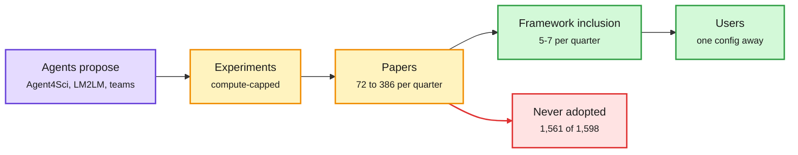

# Automated research gets measured: engineering tricks, not insight

**Sources (all HuggingFace 2026-10-22 unless noted):**
- Automating ML for Science: Can Frontier Agents Climb Scientific Hills in the Wild? (Agent4Sci), [arXiv 2610.28763](https://arxiv.org/abs/2610.28763). Also a DAIR.AI pick via X ([@dair_ai](https://x.com/dair_ai/status/2113334656183816205)). Raw: `raw/huggingface/2026-10-22-automating-ml-for-science-can-frontier-agents-climb-scientif.md`.
- FrontierCS 2: A Benchmark for Computer Science R&D, [arXiv 2610.29932](https://arxiv.org/abs/2610.29932). Raw: `raw/huggingface/2026-10-22-frontiercs-2-a-benchmark-for-computer-science-r-d.md`.
- Language Models Learn to Improve Language Models (LM2LM), [arXiv 2610.23344](https://arxiv.org/abs/2610.23344). Raw: `raw/huggingface/2026-10-22-language-models-learn-to-improve-language-models.md`.
- Building AI Research Teams for Autonomous Discovery of Linear Attention Architectures, [arXiv 2610.28887](https://arxiv.org/abs/2610.28887). Raw: `raw/huggingface/2026-10-22-building-ai-research-teams-for-autonomous-discovery-of-linea.md`.
- From RL Papers to Framework Code: Inclusion and Review in Seven Open-Source Training Frameworks, [arXiv 2610.28027](https://arxiv.org/abs/2610.28027). Raw: `raw/huggingface/2026-10-22-from-rl-papers-to-framework-code-inclusion-and-review-in-sev.md`.

## TL;DR

Five papers measure how far "AI doing AI research" actually gets. **Agent4Sci** (20 scientific ML benchmarks, 11 domains): frontier agents beat the published best on every benchmark, Claude Opus by 10.4% mean relative improvement, but almost entirely through ML-engineering tricks, not domain insight. Three failure modes recur: novelty miscalibration, under-used compute, and collapse into local engineering sweeps. Small plug-in skills (ideation, experiment management, scheduled checklists) double Opus to 20.1% and Codex from 4.4% to 8.1%. **FrontierCS 2** deletes a paper's contribution from its released code and asks agents to rebuild it inside a live repo with a private held-out suite: the best agent, Claude Opus 5.5, passes 58% of runs, and no run passes 16 of 48 tasks. **LM2LM** trains a proposer with RL against a frozen "research world model" that predicts proposal gains from real experiment records, periodically executing top proposals to refresh it; Qwen3.8-27B beats GPT-6-sol (even with 300 real records in context) at 33% lower data-generation cost. **AI research teams** of persistent agents from different disciplines, with private histories and adaptive allocation of experiments, found a linear-attention architecture that beats GDN2 (Gated DeltaNet 2) at 1.3B; removing any organizational component weakens the discoveries. **RL Papers to Framework Code** is the reality check on adoption: of 1,598 general RL-method papers (Jan 2025 to Jun 2026), only **37** reached any of seven open-source training frameworks, and the number adopted per quarter stayed at 5-7 while paper cohorts grew from 72 to 386.

Papers grow 5x; framework adoption stays flat

Agents now generate research faster than the field can absorb it.

Purple is the agent research loop, amber is output, red is the unadopted bulk, green is what reaches users.

## Key detail

- Adopted RL papers more often trained 30B+ policies (41% vs 10%) and more often changed a single coefficient, clip, mask or weight in an existing loss (29% vs 9%). Code release was equally common in both groups. Small, scalable loss edits win.
- More than nine in ten unadopted methods have no issue or PR thread naming them in any framework.

## How this relates to prior wiki pages

- **Same verdict as the 10-22 harness-evolution audit** (about 54% of gains are search-set overfitting): automated improvement is real but shallow. Agent4Sci's "bag of ML-engineering tricks" is the research-agent version. See [self-evolving-agents](self-evolving-agents.md) and [agent-benchmarks](agent-benchmarks.md).
- **Recursive Flint (10-22)** claims its Eureka Machine built a shippable 40B MoE in four months. These papers suggest asking which parts were engineering sweeps and which were design decisions.
- **The linear-attention team result feeds [attention-mechanisms](../llms-foundation-models/attention-mechanisms.md).** It also connects to today's PACE (4-bit linear-attention state): agents are now discovering architectures whose serving costs other papers are optimizing.
- **The 37-of-1,598 adoption rate quantifies a gap the digest keeps noting:** distillation and OPD refinements arrive at 2-5 per day on HF, but frameworks absorb a handful per quarter. See [rl-for-llms](../llms-foundation-models/rl-for-llms.md).

## Gaps

- Agent4Sci and FrontierCS 2 both report Claude on top; neither reports cost per improvement.
- LM2LM's research world model is a frozen LLM; its calibration on proposals far from its records is not shown.
- The linear-attention team beat GDN2 at 1.3B only.

## Research angle

Use the RL-framework tracker as a reward signal: a research agent scored on "would this be adopted" (small loss edit, scales to 30B) rather than benchmark delta would aim at what practitioners actually use.
