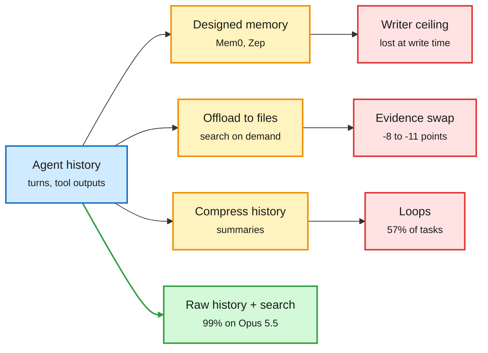

# Where context management costs agents: MemoryTax, evidence substitution, and loops under compression

**Sources:**
- MemoryTax: The Bitter Lesson of Agent Memory, [arXiv 2610.29823](https://arxiv.org/abs/2610.29823). Via X Following feed ([@omarsar0](https://x.com/omarsar0/status/2113455439648280715), [@Xudong07452910](https://x.com/Xudong07452910/status/2113472731542954118)). Not on HuggingFace this window.
- Same Simulation, Different Evidence: Where Retrieved Tool Output Costs LLM Agents Accuracy, [arXiv 2610.26836](https://arxiv.org/abs/2610.26836). HuggingFace 2026-10-22. Raw: `raw/huggingface/2026-10-22-same-simulation-different-evidence-where-retrieved-tool-outp.md`.
- DeLoop: Repeated Actions as Self-Supervision for Long-Horizon Agents, [arXiv 2610.19376](https://arxiv.org/abs/2610.19376). HuggingFace 2026-10-22. Raw: `raw/huggingface/2026-10-22-deloop-repeated-actions-as-self-supervision-for-long-horizon.md`.

## TL;DR

Three papers measure the bill for the context-saving tricks agent harnesses use. **MemoryTax** runs full context, BM25, Mem0 and Zep against three coding agents (Pi, Codex, Claude Code) on one LoCoMo conversation (419 turns, 152 questions) with GPT-4o-mini, GPT-6 Luna and Claude Opus 5.5. Designed memory only helps the weak model: Mem0 beats full context on GPT-4o-mini (78% vs 74%) but loses on GPT-6 Luna (80% vs 92%) and ties on Opus 5.5 (95%). Building Mem0's store alone costs more than a whole full-context rollout ($25.88 vs $17.84 in one reported comparison). Memory also has a **ceiling set by the writer**: a stronger reader cannot recover what a weaker writer left out. Pi, which keeps raw history and lets the model search it, hits 99% on Opus 5.5 for less than half the full-context cost. **Same Simulation, Different Evidence** offloads a geochemistry simulator's reports (up to 846.8K characters) to files the agent searches. GPT-5.1 and GPT-5.2 lose 11.3 and 7.9 points; Claude Opus 4.6 and Sonnet 4.6 lose nothing detectable. Re-running all 11,007 simulator calls shows the GPT models compute the right value as often as before. What changes is **evidence substitution**: they answer from their own higher-precision output files and misround. Naming the authoritative output recovers 6.3-7.9 points. **DeLoop** finds agents re-issue identical tool calls far more often once history is compressed (57.3% of Qwen3-8B CodeGym tasks loop). Using the loop as a DPO negative and the next non-loop action as the positive cuts that to 6.1%, with one third of the steps.

Every context-saving trick has a hidden failure mode

Memory caps what a strong reader can know, retrieval changes which evidence gets used, compression creates loops.

Blue is the history, amber is the context-saving trick, red is its measured failure, green is the strong-model baseline that wins.

## How this relates to prior wiki pages

- **Confirms the 10-22 "memory has a price" result.** Under tight budgets, sophisticated lifelong memory did no better than simple retrieval, and TokenWorth learned memory worth from execution feedback ([memory-native models and memory worth](2026-10-22-memory-native-models-and-memory-worth.md)). MemoryTax adds the model-strength axis: designed memory is a patch for weak readers. See [agent-memory](agent-memory.md).
- **Extends FEB-30 (Amazon, 10-19: QA scores and stored-state scores differ by 16.8 points and disagree on 21% of histories).** The writer-ceiling finding is the same failure seen from the reader side: what the store lost cannot be scored back.
- **Tension with Hy-Memory-30B-A3B (10-20: a 3B-active memory writer matches Opus 5 as writer across four harnesses).** If the ceiling is set by the writer, a strong specialist writer is the fix, not dropping memory. MemoryTax did not test a trained writer.
- **Evidence substitution is a model-family effect, not a harness effect.** Claude models lose nothing, GPT models lose up to 11 points under the same harness. That cuts against reporting harness choices as model-independent, the point the 10-22 Harness-Delta Attribution audit made about harness-evolution gains (about 54% overfitting).
- **DeLoop is the agent-side mirror of Cache Engineering for Agents (10-22: drop/reposition KV entries instead of summarizing).** Summarization breaks the cache and, per DeLoop, also makes agents repeat themselves. Both argue against lossy history compression. See [agent-harness-engineering](agent-harness-engineering.md).

## Gaps

- MemoryTax is one conversation, one run per cell. The authors say so.
- Same Simulation uses one scientific tool with deterministic outputs; open-ended tool outputs may behave differently.
- DeLoop's success gain shows only on Qwen3-32B (37.7% to 44.8%); on 8B success is flat while steps fall.

## Research angle

All three failures are detectable from traces without labels: writer omissions (questions whose evidence never entered the store), evidence substitution (answer values that match the agent's own file rather than the tool report), and loops (identical call, identical observation). A harness that logs these three counters would make context-management choices auditable per model.
