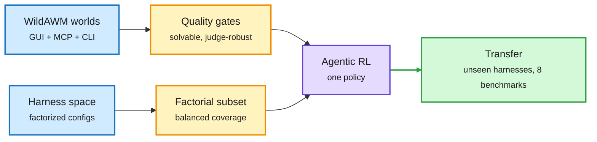

# Harness Scaling and WildAWM: train through many harnesses and many synthetic worlds

**Sources:**
- Harness Scaling for Generalizable Agentic Reinforcement Learning, [arXiv 2610.29458](https://arxiv.org/abs/2610.29458). HuggingFace 2026-10-22; DAIR Academy pick ([academy page](https://academy.dair.ai/papers/harness-scaling-for-generalizable-agentic-reinforcement-learning-2610.29458)) surfaced via [@omarsar0](https://x.com/omarsar0/status/2113315202414596098). Cross-source confirmed via social (HF + DAIR link on X). Raw: `raw/huggingface/2026-10-22-harness-scaling-for-generalizable-agentic-reinforcement-lear.md`.
- Agent World Model in the Wild (WildAWM): Computer-Use Agent Environment Synthesis, [arXiv 2610.26828](https://arxiv.org/abs/2610.26828). HuggingFace 2026-10-22 (64 upvotes) and Kurate cs.AI #9 this week: cross-source confirmed (HF + Kurate). Raw: `raw/huggingface/2026-10-22-agent-world-model-in-the-wild-computer-use-agent-environment.md`.

## TL;DR

**Harness Scaling** treats harness diversity as a scaling axis for agentic RL. Training through one fixed harness specializes the model to that harness's tool formats and context policy and transfers poorly. The paper builds a factorized harness space (tool interface, context management, coordination choices), picks a compact training subset with balanced factorial coverage, and trains each task across controlled harness variations. Models generalize to unseen white-box configurations and, more surprisingly, transfer to **unseen black-box production harnesses better than models trained through one complex black-box harness**. **WildAWM** synthesizes training worlds for computer-use agents that combine GUI, MCP services and CLI in one executable environment, using only open models. Three quality gates fix the usual synthetic-task problems: heterogeneous agent rollouts check solvability, cross-judge consistency checks the verifier, and counterfactual probes test whether the judge can be fooled. The result is 341 long-horizon environment-task pairs (some need 100+ steps); GPT-6 Astra solves only 60%. Two Qwen models trained only in these worlds improve on 8 out-of-distribution web, claw and computer-use benchmarks.

Variety in the training loop is the generalization lever

One paper varies the harness, the other varies the world. Both train the same policy across controlled diversity.

Blue is the source of diversity, amber is the selection or gating step, purple is training, green is transfer.

## How this relates to prior wiki pages

- **The training-time answer to the 10-22 harness-evolution audit.** Harness-Delta Attribution found about 54% of self-improving-harness gains were search-set overfitting ([harness evolution wave](2026-10-22-harness-evolution-wave.md)). Harness Scaling takes the opposite approach: instead of fitting a harness to a model, it makes the model robust to harness choice. Both point the same way, that harness-specific gains do not travel. See [agent-harness-engineering](agent-harness-engineering.md).
- **Agrees with OO-Harness (10-22: route each task to an evolved harness subclass) and Google's per-task harness family paper** (surfaced on X today: agents score higher when each task gets a specialized harness from a shared family). Specialize at inference, generalize at training.
- **WildAWM's judge gates answer the verifier problem VerifierBench quantifies today** (agent-written verifiers reject valid solutions more than they accept invalid ones; balanced accuracy 10.6-62.1 across 19 models). See [agent-training-environments](agent-training-environments.md).
- Related: [rl-for-llms](../llms-foundation-models/rl-for-llms.md), [gui-agents](gui-agents.md).

## Gaps

- Harness Scaling's abstract gives no compute cost for multi-harness training relative to single-harness.
- WildAWM's 341 tasks are small next to its claims; contamination with the 8 OOD benchmarks is not discussed in the abstract.
- Kurate's leaderboard this week shows every paper at the default score with a 0% win rate, so the Kurate half of the cross-source signal is presence in the top-20, not a ranking.

## Research angle

Combine the two: sample harness configurations inside WildAWM worlds, and measure whether harness diversity and world diversity are substitutes or complements at fixed RL compute.
