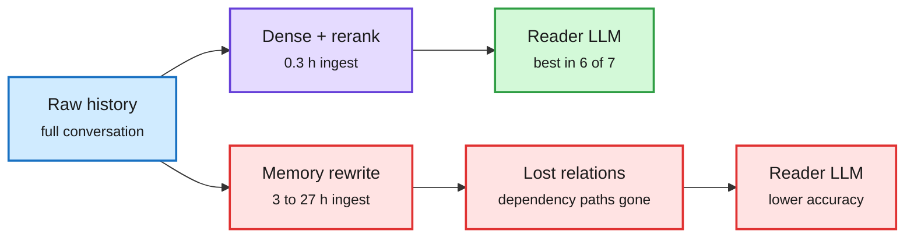

# Simple beats elaborate (agent memory and harnesses)

## Naive RAG is stronger than we thought (2610.30755), cross-source confirmed (HF + DAIR)

Raw-RAG is dense retrieval plus reranking over the raw conversation history, feeding a reader LLM. Across LoCoMo, LongMemEval, MEME and MemoryAgentBench it ranks first in six of seven benchmark-model settings, beating the strongest agentic memory system (Mem0, MemOS, Memora and others) by 0.13 to 5.53 points. Ingestion on BEAM-1M takes 0.3 hours vs 3.2 to 27 hours for the memory systems. Why: raw history keeps more of the needed evidence, including the relations and dependency paths behind an answer. Rewriting history into memory entries drops those. Even with full access to the transformed memory stores, readers answer worse than with raw evidence.

Rewriting memory loses the evidence

Retrieve from the raw log and the reader sees the dependency paths; transformed stores drop them.

Blue is the source log, purple is plain retrieval, green is the winning path, red is the rewrite path and its loss.

## Harnesses: same pass rate, up to 3x the cost (The Decoder)

A controlled study swapped coding-agent harnesses (Claude Code, OpenCode, mini-SWE-agent) under the same model. Pass-rate differences were within the variance of rerunning the same setup. Cost per task varied up to 3x, driven mainly by the system prompt being resent every step. (Paper link not in the capture; via The Decoder.)

## Anthropic: when to fold subagents into the main loop

Anthropic's guidance: many enterprise agent systems end up mirroring the org chart, one subagent per department with a central dispatcher, and every handoff loses detail ("a game of telephone"). A single main loop that loads skills and tools on demand is often better; one customer ran about 2x faster after merging. The caution: merging a customer-service subagent cut latency but broke a task that had passed, because the main agent skipped checking delivery time with the logistics specialist. Validate every merge with end-to-end evals and look specifically for newly failing tasks. Subagents still earn their keep for parallel research, independent verification and context isolation. Anthropic released a migration tool that compares quality, cost and latency before and after.

## Harness anatomy (Wavestone, via X)

A Wavestone AI Lab report read the source of 11 coding agents including Claude Code and Codex and found the same seven parts in every good one: loop, LLM layer, tools, memory, safety, orchestration, extensions (SKILL.md in 9 of 11, MCP in 8). Aider skips subagents; the rest fork them. Includes 18 design rules and a 90-line reference harness (secondhand via [@AnnatarXBT](https://x.com/AnnatarXBT/status/2113634548378374458)).

## Relation to prior wiki

- **Pattern (three in two days):** MemoryTax (10-23, designed memory like Mem0 only beats full context on weak models such as GPT-4o-mini and costs more to build than a full-context rollout), Raw-RAG today (plain retrieval beats agentic memory and ingests 10-90x faster), and the harness-cost study today (harness choice moves cost 3x but not pass rate). The shared claim: elaborate context machinery is mostly a cost line, not a capability.
- **Confirms** the 10-20 "thin harness wins in production" entry on [agent-harness-engineering](agent-harness-engineering.md) and the 10-22 Harness-Delta Attribution audit (~54% of harness-evolution gains are overfitting).
- **Partial tension:** Shopify's 7x / 90%-fewer-tokens result ([routing summary](../ai-routing/2026-10-24-routeweaver-and-small-tool-selectors.md)) adds structure (small reading models) and wins. The difference: Shopify's structure removes tokens from the expensive model; the losing designs add tokens (resent prompts, rewritten memory).

→ Concept pages: [agent-memory](agent-memory.md) · [agent-harness-engineering](agent-harness-engineering.md) · [multi-agent-systems](multi-agent-systems.md)
