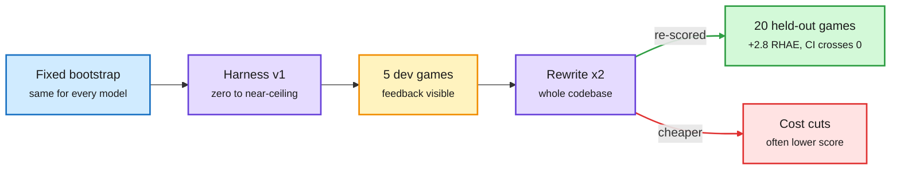

# Can LLMs improve their own harness? A controlled study on ARC-AGI-3

**Source:** arXiv [2610.30499](https://arxiv.org/abs/2610.30499) (Jens Lehmann, Sahar Vahdati; Amazon / TU Dresden, Leibniz Univ. Hannover / TIB). DAIR.AI Academy pick ([page](https://academy.dair.ai/papers/can-llms-improve-their-own-harness-a-controlled-study-on-arc-agi-3-2610.30499)), surfaced via [@omarsar0](https://x.com/omarsar0/status/2114050042705379461) · raw: `raw/twitter/feed/2026-10-25-morning-ranked.json`
**Topic:** harness engineering, self-improving agents

## TL;DR

Each frontier model writes a complete harness for ARC-AGI-3 (interactive games where the agent must discover the goal) from a fixed coding bootstrap, plays five development games, then rewrites its whole codebase twice. Every version is scored on 20 held-out games that never feed back. Across 27 lineages, first harnesses range from zero to near-ceiling, but two rewrites raise mean held-out RHAE (Relative Human Action Efficiency: level completion weighted by action efficiency against humans) by only 2.80 points, with a 95% interval of -1.44 to 7.35. Development-game gains overstate held-out gains, and revisions that cut dollar inference cost often lower the score. Human-steered harnesses still score higher.

Most of the quality is set in draft one

Rewrites tune to the five games the model can see, not the twenty it cannot.

Blue is the shared start, purple are harness versions, amber is the visible feedback, green is the held-out score, red is the cost-cut failure mode.

## Relation to prior wiki pages

- **Confirms** the 10-22 HDA audit on the [harness concept page](agent-harness-engineering.md) (about 54% of harness-evolution gains are overfitting to the search set). Two independent groups now find self-revision mostly overfits. Pattern n=2 with clean held-out splits.
- **Contrasts** with Harness Scaling (10-23: training across many harnesses transfers) and Google Cloud's specialized-harness router (10-22/24: +16 points with inheritance and a router). The difference: those had a search loop with held-out selection or RL; here the model revises open-loop from five games.
- **Cost axis:** the finding that cheaper revisions lose score matches the 10-24 harness-cost study (cost varies 3x across harnesses while pass rate barely moves) from the other side: cost cuts made by the model itself are not free.
