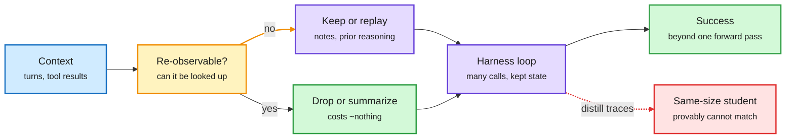

# What a harness actually adds: unrecoverable state, a provable gap, racing, and 1,024 peers

**Sources:**
- [When the harness decides success: state that cannot be re-observed (2610.26632)](https://arxiv.org/abs/2610.26632), Microsoft. DAIR pick, Oct 20
- [Understanding the Benefits of Scaffolds through Computational Separations (2610.27157)](https://arxiv.org/abs/2610.27157), CMU. DAIR pick, Oct 21
- [Forging More Tasks into Better Harnesses: Successive Scale Racing (2610.28815)](https://arxiv.org/abs/2610.28815), Michigan State and Snap. DAIR pick, Oct 22
- [Agensh (2609.26781)](https://arxiv.org/abs/2609.26781), Microsoft, code open-sourced 2026-10-24 ([repo](https://github.com/microsoft/Agensh)); surfaced on the X Following feed
- Raw: `raw/dair/2026-10-25-213702-dair-academy.md`, `raw/twitter/feed/2026-10-25-*-ranked.json`
**Topic:** agent harness engineering

## TL;DR

Four results answer "what does a harness buy, and can you keep it?" **Lencevicius (Microsoft)** shows with pre-registered experiments that truncating context costs a reasoning model nothing when the needed fact can be looked up again, and drops it to chance when it cannot; the two penalties differ by 92.5 points. On ARC-AGI-3, summarizing old turns while keeping an invitation to take notes recovers 86% of a 63-point gap between two harnesses, and replaying the model's earlier reasoning recovers the rest. **Gai, Risteski and Block (CMU)** prove that a harness can compute an NL-complete closure of even a trivial AC0 primitive, which no fixed-depth forward pass can represent if NL is not in TC0; a student distilled from harness traces therefore cannot match the harness without more capacity, an easier task or a longer chain of thought, and experiments confirm all three. **Successive Scale Racing (SSR)** finds that harness evolution gets worse as the task pool grows because evidence selection is poor; racing diverse candidates and dropping weak ones early lifts pass rate from 64.3% to 68.3% as the pool grows 40 to 200 tasks, with 60% fewer validation runs. **Agensh** removes the orchestrator: up to 1,024 identical workers claim sub-tasks through a shared Git repo, chat channel and findings board; on the five hardest ProgramBench tasks, 128 agents lift mean test-pass rate from 19.31% to 28.78%.

Keep what cannot be fetched again; drop the rest

The harness's value is the state and the loop it holds outside the weights.

Blue is the incoming context, amber is the keep-or-drop test, purple is the harness, green is what is safe to drop and the result, red is the distilled student that falls short.

## Key findings

- **Unrecoverable state decides success.** Truncation penalty: ~0 when re-observable, chance when not (92.5-point gap, 90% CI 89.5-95.5; replicated on a second provider). On ARC-AGI-3: summary + note-taking invitation recovers 86% of a 63-point gap; without the invitation, 43%; native reasoning replay recovers the remaining 57%. Single runs per configuration.
- **The harness gap is representational.** Distilled students underperform even simple scaffolds with small models; the proof ties this to NL vs TC0. The gap reappears for an agentic harness on competition math.
- **More tasks hurt harness evolution unless you race.** SSR builds evidence combinations by task quality and coverage, races candidates under a small budget, and is the only method that improves as the pool grows. State of the art in six of six configurations on three benchmarks.
- **Agent count is a scaling axis, with weak early returns.** 1 to 8 agents adds only 1.37 points on the five-task mean. Pandoc: 33.89% (1 agent) to 55.06% (1,024 agents) in six hours; with GPT-6.1-sol, 56.19% to 79.59% at 32 agents. Token cost is not reported.

## Relation to prior wiki pages

- **Explains the context-management failures of 10-23.** That digest found that offloading tool output costs GPT models 8-11 points through evidence substitution and that compression makes agents loop. Lencevicius gives the rule: the damage comes from losing state that cannot be fetched again.
- **Gives a theory for Harness-Aware Distillation (10-07)**, where plain OPD changed attention but not success: per the CMU proof, a same-class student cannot internalize a harness from traces. This also bounds the "train with it, serve without it" pattern on the [test-time compute page](../inference-efficiency/test-time-compute-allocation.md).
- **SSR answers the overfitting warning** from HDA (10-22: about 54% of harness-evolution gains are overfitting) and the ARC-AGI-3 self-revision study (10-25: two rewrites add 2.8 held-out points that may be zero). Selection with racing on a large pool is the kind of held-out discipline both called for.
- **Agensh vs Anthropic's "fold subagents back in" (10-24).** Anthropic says one agent with skills often beats many; Agensh says 1,024 peers beat one under a fixed wall-clock budget. Both can be true: Agensh optimizes latency on huge tasks and does not report cost, while Anthropic optimizes cost and speed on ordinary ones. First covered on [09-24](2026-09-24-self-organizing-agent-teams.md); new today is the code release.

Related: [agent-harness-engineering](agent-harness-engineering.md) · [multi-agent-systems](multi-agent-systems.md) · [ARC-AGI-3 harness study (10-25)](2026-10-25-llms-improve-own-harness-arc-agi-3.md) · [context-management costs (10-23)](2026-10-23-context-management-costs-memorytax-evidence-deloop.md)
