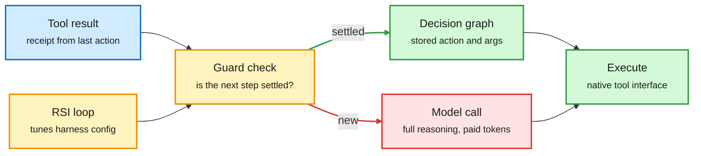

# HarnessMM: reuse the agent's settled decisions, plus MCP faults and harness-evolution tooling

**Date:** 2026-10-27 · **Sources:** [HarnessMM (2610.32813)](https://arxiv.org/abs/2610.32813) via [@omarsar0](https://x.com/omarsar0/status/2114732037827662278) and @dair_ai · [MCP-Injector (2610.32555)](https://arxiv.org/abs/2610.32555) via [@dair_ai](https://x.com/dair_ai/status/2114735562716545201) · [RSIHub (2610.32253)](https://arxiv.org/abs/2610.32253) (HF 10-26) · [Hermit](https://github.com/Infini-AI-Lab/hermit) · [AWS prompt caching for agents](https://aws.amazon.com/blogs/machine-learning/groundhog-day-for-ai-agents-prompt-caching-patterns-for-using-openai-models-on-amazon-bedrock/)
**Raw:** `raw/twitter/feed/2026-10-26-*-ranked.json`, `raw/huggingface/2026-10-26-rsihub-*.md`, `raw/labs/2026-10-26-230449-labs.md`

## TL;DR

Agent harnesses call the model again after every tool result, even when an earlier call already fixed what happens next. HarnessMM ("Harness Minus Minus") stores those settled decisions in an **Executable Decision Graph**: the exact action, its literal arguments, its dependencies and a guard condition. When the guard holds, a controller at the model-tool boundary runs the stored action and skips the model call. Anything new goes back to the model. A recursive self-improvement loop tunes the harness configuration from training feedback while model weights stay frozen. On a DeepSeek harness, tokens per task fall from 96.28k to 11.62k (an 88% cut) while success rises from 71.43% to 85.71%. On HumanEval with Codex, success holds at 90.82% and tokens fall 29.5%. An MBPP ablation shows 26.9% lower cost than single-use graphs and 19.5% lower than keeping the callbacks.

Settled decisions skip the model

One guard check sits between the tool result and the next model call.

Blue is input, amber is a decision or tuning loop, red is the expensive model path, green is the cached path.

## Key points

- **Decision caching, one layer above prompt caching.** Prompt caching (AWS's same-day post: store the prefill KV state of a stable prefix and reuse it) makes each model call cheaper. HarnessMM removes calls. The two stack.
- **The guard is what keeps it safe.** A stored decision only fires when its public guard is satisfied by the observed receipts. New semantic decisions, unsupported evidence or selector abstention fall back to the original model.
- **Weights never change.** All gains come from the harness configuration and the reuse controller. This is the "thin harness that removes tokens from the expensive model" pattern the wiki recorded on 10-24.
- **Gap:** the DeepSeek harness result is one harness and a small task count (success moves in 1/14 steps: 71.43% to 85.71%). No held-out harness test, which matters given HDA (10-22) found ~54% of harness-evolution gains are overfitting.

## MCP-Injector: scale does not buy fault tolerance

A protocol-aware proxy injects tool failures into MCP (Model Context Protocol) calls, with permanent, transient and intermittent faults. The fault mix is calibrated on 57,240 issue and PR threads across 1,774 open-source MCP repos. Across 1,350 runs (gpt-oss-20B and 120B, three agent stacks), the task score falls 60%, from 8.08 to 3.23 out of 10. The 120B keeps no larger share of its fault-free score (p = 0.96) and completes slightly less often under faults (91.1% vs 95.6%). Stack differences beat model-size differences. NeurIPS 2026.

## Harness-evolution tooling: RSIHub and Hermit

- **RSIHub** (HF 10-26) puts AHE, Hyperagents, A-Evolve and GEPA on one execution, evaluation and lineage substrate, with evaluation kept outside the mutable surface. Largest gain +13.5 pass@1 points on Terminal Bench 2 and τ³ Banking, but method rankings change across settings and gains do not always transfer to held-out tasks.
- **Hermit** (Infini-AI Lab) open-sources harness evolution that trains reusable adapters without changing the model or the harness.
- Both reinforce the 10-25 finding (LLMs improving their own harness: dev gains overstate held-out gains): the community is building shared infrastructure precisely because comparisons were not reproducible.

## Relation to prior wiki

- **Extends** the 10-24 harness cost study (cost per task varies up to 3x across harnesses, mainly from the resent system prompt): HarnessMM attacks the other big cost, repeated reasoning.
- **Pairs with** DAIR's "Are Self-Evolving Agents Continual Learners?" (2610.25858, plasticity vs stability r = -0.72): global harness edits interfere with unseen tasks; HarnessMM's guarded local reuse is one way to keep edits local.
- Concept pages: [agent-harness-engineering](agent-harness-engineering.md), [self-evolving-agents](self-evolving-agents.md), [tool-calling](tool-calling.md), [kv-cache](../inference-efficiency/kv-cache.md).
