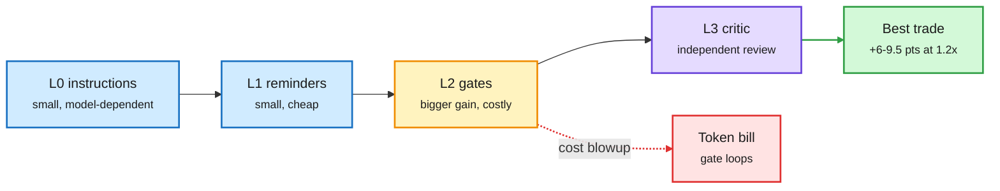

# Where the checker goes: harness verification, TraceTrial-Bench, MANDATE, AuthorizationBench

**TL;DR.** Four results on checking agent work. **Rethinking Verification in Agent Harnesses (2610.34577, Alibaba + Cornell)** compares 17 verification designs on seven frontier coding models across four lifecycle layers: initial instructions, mid-turn reminders, completion gates, and independent review. Instructions and reminders give modest, model-dependent gains. Gates give more but can blow up cost. An independent critic is the best trade: +5.9 to 9.5 points on Terminal-Bench at 1.13-1.25x cost, +3.9 to 6.6 on SWE-bench Verified at 1.00-1.04x. Extra review rounds add up to 3.5 more points. **Trial by Trace (2610.32285)** benchmarks harnesses, not models: 95 tasks over seven components (context, execution, governance, lifecycle, observability, tools, verification), 4 harnesses x 9 models = 3,420 runs. Harness scores range 59.8-72.0%, and 31.1% of runs succeed at the task while failing at least one harness criterion. **MANDATE (2610.34748, Microsoft Research + Georgia Tech)** mines 163,487 Reddit posts into 23 delegation-failure categories; the most severe are the hardest to notice, and "agent keeps running without progress" is common but barely studied. **AuthorizationBench (2610.27548)**: agents act outside granted scope in 19.2% of 6,864 trajectories, even when they finish the task.

Four places to check, one clear winner per dollar

The critic at the end beats gates in the middle on accuracy per cost.

Blue are cheap prompt-level checks, amber is the gate, purple is the critic, green is the best trade, red is the cost risk.

## Relation to prior wiki pages
- [Agent harness engineering](agent-harness-engineering.md): Harness Scaling (10-23) and the harness-cost study (10-24, cost varies 3x across harnesses at equal pass rate) argued thin harnesses beat token-adding ones. The critic result fits: one extra pass at the end, not reminders sprinkled everywhere.
- Trial by Trace's "31.1% succeed while breaking a harness rule" is the benchmark version of AuthorizationBench's 19.2% out-of-scope rate: task success hides process failure.
- HarnessMM (10-27, decision reuse cut tokens 88%) and today's critic both price verification as test-time compute.

Raw: [verification](../../raw/huggingface/2026-10-27-rethinking-verification-in-agent-harnesses.md) · [Trial by Trace](../../raw/huggingface/2026-10-27-trial-by-trace-benchmarking-ai-agent-harnesses-for-reliabili.md) · [arXiv 2610.34577](https://arxiv.org/abs/2610.34577) · [arXiv 2610.32285](https://arxiv.org/abs/2610.32285) · [MANDATE](https://arxiv.org/abs/2610.34748) · [AuthorizationBench](https://arxiv.org/abs/2610.27548)
