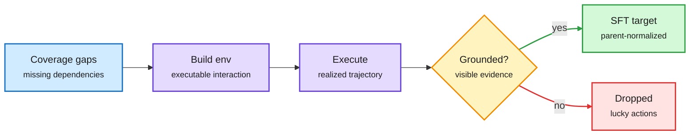

# Building learnable experience: Trajectory2Gym and DynaFlow

**TL;DR.** **Trajectory2Gym (2610.33568, HF #1 with 343 upvotes)** argues that successful tool-use trajectories are poor supervision when they skip multi-step dependencies or contain actions not justified by what the agent could see at the time. It builds executable interactions around under-covered compositional structures and supervises only "decision-grounded" actions (supported by the visible history), with parent-normalized SFT so each semantic interaction gets one unit of weight. Across five Qwen3 sizes it lifts the Tau1/Tau2/BFCL mean by 16.9-29.8 points, most in stateful multi-turn tasks. **DynaFlow (2610.34467)** puts workflow synthesis into the main agent's action space: it writes small programs that call fixed sub-agents in sequence or parallel with verification. Only the orchestrator is trained (SFT on distilled trajectories, then filtering for unsupported premises and biased verification). 88.08% across six benchmarks, +10.9 points over the best baseline on the same Qwen3.5-27B.

Supervise the decisions the agent could actually justify

Success is not the filter; visible-evidence support is.

Blue is the gap finder, purple is environment building, amber is the grounding gate, green is kept supervision, red is discarded actions.

## Relation to prior wiki pages
- [Agent training environments](agent-training-environments.md): fits the month's "environment as curriculum" thread (EnvLunch today: the environment as a free lunch for learning to interact).
- DynaFlow is the trained version of the subagent-orchestration question in [multi-agent systems](multi-agent-systems.md); contrast with Anthropic's 10-24 advice to fold subagents back into the main loop when handoffs lose detail.

Raw: [Trajectory2Gym](../../raw/huggingface/2026-10-27-trajectory2gym-decision-grounded-compositional-interaction-s.md) · [DynaFlow](../../raw/huggingface/2026-10-27-dynaflow-learning-free-form-multi-agent-orchestration.md) · [arXiv 2610.33568](https://arxiv.org/abs/2610.33568) · [arXiv 2610.34467](https://arxiv.org/abs/2610.34467)
