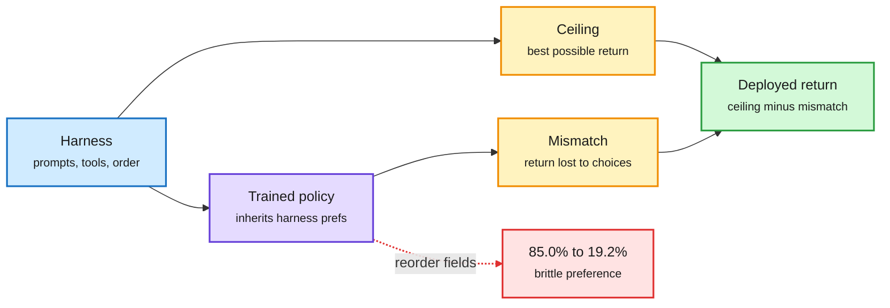

# Your policy is secretly a harness; self-evolving harnesses (Trinity, EMMA, HaMo) and their limits

**Sources (HuggingFace 2026-10-28 + X feed):** [Your Policy Is Secretly a Harness, 2610.37255](https://arxiv.org/abs/2610.37255) · [The Trinity, 2610.36077](https://arxiv.org/abs/2610.36077) (HF #1, 535 upvotes) · [EMMA, 2610.35966](https://arxiv.org/abs/2610.35966) (Amazon, via [@omarsar0](https://x.com/omarsar0/status/2115438189901181296) and DAIR) · [HaMo, 2610.34724](https://arxiv.org/abs/2610.34724) · [Are self-evolving agents continual learners?, 2610.25858](https://arxiv.org/abs/2610.25858) (via [@xiaoyin_chen66](https://x.com/xiaoyin_chen66/status/2115162450660340135)) · [h1, 2610.35962](https://arxiv.org/abs/2610.35962) · [TTME, 2610.32046](https://arxiv.org/abs/2610.32046).

**TL;DR.** The harness (the prompts, tools and control logic around a model) is now treated as a trainable object, and today's papers say how to measure it and where self-editing breaks.

- **Your Policy Is Secretly a Harness.** Under KL-regularised control, a trained policy's log-odds recover how strongly its harness favoured each action, so the model *carries its harness's preferences*. Deployed return = the harness's **ceiling** (best return it offers) minus the policy's **mismatch** (return lost to its own choices). Training changes only mismatch; changing the harness moves both. So "compare harnesses with a fixed model" confounds the two. On MiniWoB++, merely reversing the order of observation fields (no optimal decision changes) drops a trained model from 85.0% to 19.2%. Harnesses a fixed-model comparison rejected but that raise the ceiling beat the original after retraining; ceiling minus mismatch (with a stronger model standing in for the optimum) reproduces the Terminal-Bench Lite ranking where neither term alone does.
- **The Trinity.** A Creator / Explorer / Evolver loop reorganises tasks by shared *capability* rather than surface category, builds simplified verifiable simulated worlds per capability, and evolves a tree of reusable harness modules. A capability-aware **harness router** picks a module configuration per task. +34 points mean across 28 training benchmarks and +26 across 18 unseen ones.
- **EMMA (Amazon).** Treats a multi-agent system's controller routing memory, specialist prompts and per-step skills as episodic memory. After a failure, a reflector decides which of the three *owns* the fix and proposes one scoped, bounded edit. Beats ACE, GEPA, EvoMAS and ADAS by up to 32.5% on KramaBench, AppWorld and BBEH with 17-38% fewer training executions.
- **HaMo.** Fast non-parametric "experience cards" for immediate reuse plus slow parametric training that teaches the model to execute retrieved strategies. Beats harness-only and model-only adaptation under domain shift.
- **Counter-evidence: self-evolving agents are not continual learners.** ReasoningBank, GEPA and Meta-Harness, run on four drifting task streams (BIRD, BFCL, ScienceWorld), improve aggregate scores but trade stability for plasticity: global edits to a shared prompt overwrite earlier knowledge as the stream shifts.
- **h1 (bitter lesson for theorem proving).** A plain loop with an efficient Lean 4 interface matches or beats specialised workflows (Goedel-Architect, AlphaProof Nexus) at matched models and settles eight open FormalConjectures problems. The interface, not the workflow, sets cost and solve rate.
- **TTME.** Evolving an external memory at test time beats test-time training on five math discovery tasks at 82.8-84.6% fewer FLOPs.

Return = what the harness allows minus what the model misses

Training shrinks the gap; only a new harness raises the ceiling.

Blue is the harness, purple is the trained model, amber are the two terms, green is what you get, red is the brittleness.

## Relation to prior wiki
- **Explains** a pattern in [agent harness engineering](agent-harness-engineering.md): the 10-24 harness-cost study found 3x cost spread across harnesses at equal pass rate, and the 10-28 Trial by Trace benchmark scored harnesses rather than models. Ceiling vs mismatch says *why* fixed-model harness comparisons mislead.
- **N-of-a-kind on routers inside harnesses**: Trinity's capability-aware harness router, EMMA's controller routing memory, and Copilot Fusion's cross-lab model router all put a routing decision inside the harness. See [LLM routing](../ai-routing/llm-routing.md).
- **Contradiction, unresolved**: Trinity and EMMA report large gains from self-editing harnesses; the continual-learning paper finds the same family forgets under drift. EMMA's scoped single edits are the most plausible fix, but it was not tested on drifting streams. See [self-evolving agents](self-evolving-agents.md).
- **Bitter-lesson echo**: h1 joins Axiom's CFSG formalisation (10-28), which credited harness design over model size.
