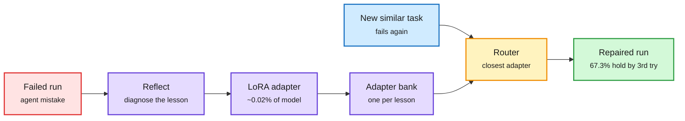

# Agents that keep their lessons: LoRA repair adapters, co-evolving rubrics, the Sharpening Tax, and a 4B hybrid computer-use agent

**Sources:** Self-Direction (Princeton + Meta, [@rohanpaul_ai](https://x.com/rohanpaul_ai/status/2115898609304801525)) · [RuHarness, arXiv 2610.36826](https://arxiv.org/abs/2610.36826) ([@dair_ai](https://x.com/dair_ai/status/2115987068761628740)) · [Sharpening Tax, arXiv 2610.01509](https://arxiv.org/abs/2610.01509) ([@rohanpaul_ai](https://x.com/rohanpaul_ai/status/2115854746456346784)) · [Mage-VL-Cowork model card](https://huggingface.co/microsoft/Mage-VL-Cowork) · [RSIHub, arXiv 2610.32253](https://arxiv.org/abs/2610.32253) · [Memory Tax, arXiv 2610.34073](https://arxiv.org/abs/2610.34073). raw: `raw/twitter/feed/2026-10-30-evening-ranked.json`, `raw/labs/2026-10-30-183651-labs.md`.

**TL;DR.** Agents fix a mistake inside a session and then repeat it next session, because notes in context get dropped and full fine-tuning is expensive and disrupts other skills. Self-Direction trains each lesson into a LoRA adapter about 0.02% of the model's size and uses a router to load the closest adapter when a similar task fails. With Qwen3.6-27B, GAIA success rose from 38.8% to 55.8%, beating in-context reflections and a Skills.md file; across 185 earlier mistakes, 67.3% of repairs still held by the third encounter versus 42.9% for plain retrying. RuHarness attacks a different stall: harness-evolution methods keep the critic's criteria fixed, so after a few rounds the criteria stop matching the agent's real weaknesses. It evolves the rubric with the harness (criteria that stop firing go dormant and return if the weakness reappears), beating the strongest harness-evolution baseline by 4.5 points on held-out tasks with Qwen3.5-35B-A3B and 5.3 with GLM-4.7-Flash. Two deflating results frame both: Meta's Sharpening Tax (RL post-training raises first-try accuracy but shrinks how many tasks are ever solved in 128 tries, positive in 36 of 42 pairs), and RSIHub (self-evolution gains of 13.5 points on a weak base shrink to 2.2 on Codex, with some held-out regressions).

Each fix becomes a tiny adapter the agent can reload

The router, not the context window, decides which lesson comes back.

Red is the failure, blue is the new task, purple is the lesson pipeline, amber is the adapter router, green is the repaired run.

## Mage-VL-Cowork (Microsoft, open weights, Apache-2.0)

A 4B vision-language policy (Mage-ViT + Qwen3-4B) that chooses per turn between GUI clicks (`computer_use`) and a persistent shell (`bash`), with no external orchestrator. 66.0% on OSWorld-Verified at a 50-step budget, best at 4B. The notable efficiency facts: evolving the *teacher's* harness first (pruning overlapping tools like xdotool and accessibility trees, preinstalling python-pptx/openpyxl/pandas) lifted the GPT-5.4 teacher to 92.0% with 29.2% fewer steps and gave the student +12.5 points; workflow-first task synthesis cut generation tokens 93.3% (1,276K to 85K per task) and cost from $0.906 to $0.158 per task; online GRPO added +10.16 points while cutting model calls 13.0% and output tokens 25.4%. A screenshot costs thousands of tokens, so routing structured edits to the shell is a token-cost decision as much as a capability one.

## How it relates to prior wiki pages

- **Gap-filling.** The 10-27 [self-evolving agents](self-evolving-agents.md) entry and the 10-29 continual-learning study found global prompt edits overwrite earlier knowledge under drift. Self-Direction's per-lesson adapters are a direct answer: lessons are isolated in weights and recalled by a router, so one fix cannot overwrite another. Whether adapter banks scale past hundreds of lessons is open.
- **Confirms** the 10-29 EMMA result (scope each self-edit to one owner) from a different angle: RuHarness scopes each *critic* criterion to one live weakness.
- **Contradiction stays open.** RSIHub and the Sharpening Tax say much of the measured gain is environment fitting or narrowed coverage. Self-Direction's 38.8% to 55.8% on GAIA needs a held-out split to rule that out.
- **Memory Tax (10-28, still circulating)**: dedicated memory systems often underperform raw-history RAG; keep a raw-history retrieval channel. Self-Direction moves memory into weights, which sidesteps the summarization loss that Memory Tax blames.
- Mage-VL-Cowork's GUI/shell switch is turn-level routing inside one policy; see [LLM routing](../ai-routing/llm-routing.md) and [GUI agents](gui-agents.md).

## Related

[Self-evolving agents](self-evolving-agents.md) · [Agent harness engineering](agent-harness-engineering.md) · [Agent memory](agent-memory.md) · [RL for LLMs](../llms-foundation-models/rl-for-llms.md)
