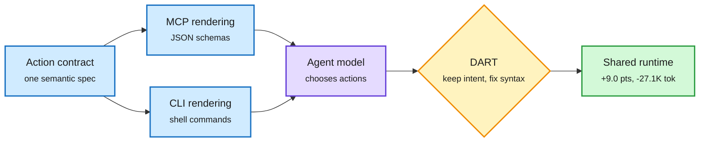

# MICA and DART: MCP vs CLI changes agent behavior even with matched capabilities (2026-10-31)

**Source:** cross-source confirmed (HF + Kurate): HuggingFace Daily Papers 2026-10-30 and Kurate cs.AI weekly #14 · [arXiv 2610.34298](https://arxiv.org/abs/2610.34298) · raw: `raw/huggingface/2026-10-30-matched-capabilities-different-behaviors-a-controlled-study.md`, `raw/kurate/2026-10-31-cs-ai.md`

## TL;DR

The Model Context Protocol (MCP: a JSON tool-schema interface) and a command-line interface (CLI) can expose the same operations. Does the representation matter if capabilities are identical? MICA (Matched Interface Comparison and Analysis) renders both from one shared semantic action contract and routes decoded actions through the same runtime, so only the model-facing presentation differs. Across six models and three interactive environments, matched interfaces produce large differences in task score and interaction cost, in which actions get chosen, how failures happen and how recovery goes. Paired trajectories diverge structurally in 94.3% of 2,004 episodes, and early differences propagate. Matched-state probes localize the sensitivity to three places: how capabilities are presented, how actions are realized (syntax), and what feedback looks like. DART (Decoupled Action Realization and Targeted Repair) keeps the model's validated semantic intent and repairs only the interface-specific realization: +up to 9.0 points in all six settings, and up to 27.1K fewer MCP tokens per task.

Same tools, different face, different agent

MICA holds the capability fixed; DART repairs the syntax layer without touching the intent.

Blue is the interface, purple is the model, amber is the repair layer, green is the shared execution and its result.

## Gaps

Three environments; the abstract does not say which interface wins on average, only that they differ. No test of whether training on one interface transfers. Token savings are reported for MCP only.

## Relation to prior wiki

- **Confirms** the [agent-harness-engineering](agent-harness-engineering.md) thesis that the harness is part of the policy: HarnessBridge (06-14) learned the observation/action projection; MICA proves the projection alone moves outcomes with capability held fixed.
- **Cost angle for** [tool-calling](tool-calling.md): MCP schemas are token-heavy; DART's 27.1K tokens per task saved is the same order as the 10-29 AKV result (agents trimming context via cache `drop` ops, -27.7% cost).
- Industry context: Ken Huang (10-30) argues MCP commoditized integration wrappers (10,000+ public servers, 97M monthly SDK downloads at donation); MICA says the wrapper's *shape* still matters.
