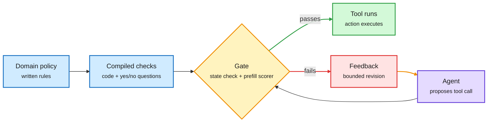

# JevAct and Siemens' NeMo Gym verifier: the check, not the model, fixes the agent

**Date:** 2026-11-01 · **Sources:** [JevAct, arXiv 2610.38620](https://arxiv.org/abs/2610.38620) (IBM; DAIR Academy pick Oct 31, surfaced by [@omarsar0](https://x.com/omarsar0/status/2116547247018229999)); [NVIDIA tech blog on Siemens Fuse EDA agent](https://developer.nvidia.com/blog/optimizing-agent-reliability-and-tool-calling-efficiency-for-chip-design-using-nvidia-nemo-gym/) (surfaced by [@NVIDIAAI](https://x.com/NVIDIAAI/status/2116236342653026706)) · **Raw:** X Following-feed captures 2026-10-31 evening

## TL;DR

Two independent results, one lesson: put a verifier around the agent and keep the model fixed. **JevAct** (IBM) inserts a runtime gate between a tool-using agent and its tools. An LLM first compiles the domain policy into executable state checks plus yes/no questions. Before a selected tool call runs, the code checks verify facts in the tool records, and a *prefill-only* decision model scores the yes/no questions from token probabilities without generating text. A failed call goes back to the agent with feedback for a bounded revision. On τ²-bench Telecom, Opus 4.6's three-run success rose from 39.5% to 80.7%, and all eight agents improved by 16.9 points on average; all nine improved on BFCL; Airline was mixed. **Siemens EDA** built a domain verifier in NVIDIA NeMo Gym for its chip-design agent (it writes Liberty files, the timing and power models of standard cells). The verifier grades only the final artifact and gives zero reward if any gate fails. Using its diagnostics to rewrite skills and MCP tool descriptions raised the composite verification score from about 55% to 95%, while agent turns fell from 155 to 53 and output tokens from about 81K to 29K.

The gate sits between the agent and the world

Nothing in the model changes; a cheap check decides whether the action runs.

Blue is policy input, purple is the agent, amber is the gate, green is the executed action, red is the rejection path.

## Key points

- **Prefill-only scoring is the efficiency trick.** The decision model reads the context and the question once and reads off the yes/no probability. No generation, so the gate costs roughly one prefill per check.
- **Stated limits (JevAct).** The Telecom gain disappears with a gpt-oss-120b user simulator. On 260 labelled development write calls, 42 of 101 incorrect calls break no compiled question, so the compiled policy misses about 40% of bad actions.
- **Cost falls with reliability (Siemens).** Fewer turns and about 64% fewer output tokens came from better tool descriptions and skills, found by a verifier that blames the stage where an error started.

## How it relates to prior wiki pages

- **Third data point for small decision models as gates.** [Small decision models as routers (10-28)](../ai-routing/2026-10-28-small-decision-models-as-routers.md) showed 68M-150M scorers can make routing calls in 14 ms; JevAct uses the same "score, don't generate" idea as an action gate.
- **Confirms the interface-is-policy thread.** [MICA/DART (10-31)](2026-10-31-mica-mcp-vs-cli-interfaces.md) found re-rendering identical tools changes 94% of trajectories and a syntax-repair layer adds up to 9 points. Siemens' gain from rewriting tool descriptions is the production version of that finding.
- Concept pages: [agent-harness-engineering](agent-harness-engineering.md), [tool-calling](tool-calling.md), [llm-routing](../ai-routing/llm-routing.md).
