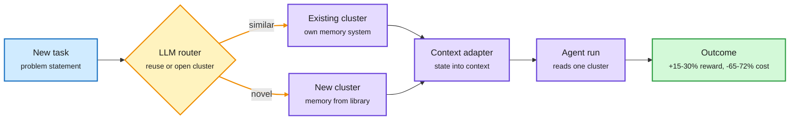

# Routed Continual Learning: route an agent's past, not just its prompt

**Date:** 2026-11-01 · **Paper:** [arXiv 2610.38796](https://arxiv.org/abs/2610.38796) (Philip, Balakrishnan, Geraghty, Mao, Venkat, Mironov; FAIR at Meta) · **Signal:** DAIR Academy pick (Oct 31, "Training · Memory · Agents"), surfaced on X by [@dair_ai](https://x.com/dair_ai/status/2116548002617917603) · **Raw:** X Following-feed capture `raw/twitter/feed/2026-10-31-evening-233002-ranked.json`

## TL;DR

Agents that see a stream of mixed tasks are usually given one global history of past runs in context. Routed CL shows that this baseline collapses when task types are interleaved: on a mixed stream it gains only +0.015 normalized reward over no memory at all. The fix is a router. Past trajectories are grouped into clusters, each cluster keeps its state in one memory system picked from a fixed library (raw in-context history, a summary, a retrieval store and so on), and before every run an LLM router either reuses a cluster or opens a new one. On 301 CL-Bench instances interleaved with 97 τ³-Bench banking instances, across four LLMs, Routed CL lifts reward over global history by 15-30% of the maximum attainable reward and cuts estimated API cost by 65-72%.

Route the past, not just the prompt

The router decides which slice of experience a task may read before the agent starts.

Blue is the task, amber is the routing decision, purple is memory and the agent, green is the result.

## Key points

- **Global history fails on mixed work.** Global ICL (every past trajectory in context) was the strongest system on isolated CL-Bench tasks, yet it barely beats stateless when tasks interleave (+0.015). Mixing unrelated experience dilutes the useful part.
- **Two decisions per run.** The router picks *which cluster* (what experience belongs together) and, at creation time, *which memory system* that cluster uses. A Context Memory Adapter maps each memory system's state into the agent's context through one shared interface.
- **Reward and cost move together.** +15-30% of max reward over global history and 65-72% lower estimated API cost, because each run reads a smaller, more relevant context.
- **Stated limits.** Runs were sequential; parallel agents writing to the same cluster are untested. Router quality on long, drifting streams is not measured.

## How it relates to prior wiki pages

- **Partial contradiction with the memory-tax thread.** [Naive RAG is stronger than we thought (10-24)](2026-10-24-naive-rag-harness-cost-fold-subagents.md) and [the memory tax (10-28)](2026-10-28-memory-tax-and-cheap-checks.md) found that raw history plus retrieval beats designed memory systems, because rewriting history drops facts. Routed CL agrees that no single designed memory wins, but shows *undifferentiated* raw history also fails once tasks interleave. The reconciliation: keep raw detail, but partition it. Whether a retrieval-over-raw-history baseline (the 10-24 winner) would match Routed CL on this stream is untested.
- **Extends the routing frame.** [LLM routing](../ai-routing/llm-routing.md) has tracked routing over models (10-29 Copilot Fusion), over trajectory stages (10-30 AgentBaton), over decoding steps (10-31 LOWN). Routed CL routes over *memory*: the same cheap-decision-saves-expensive-tokens bet.
- Concept pages: [agent-memory](agent-memory.md), [llm-routing](../ai-routing/llm-routing.md), [self-evolving-agents](self-evolving-agents.md).
