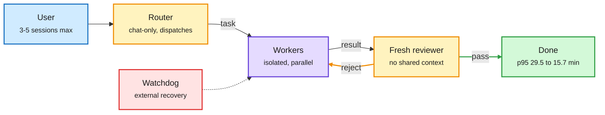

# DeepSeek Super-agent and the fresh-context reviewer pattern

**Sources:** DeepSeek Harness team, "Super-agent" technical post and open-source prototype (weekend of 2026-11-01), via The Information and X summaries; Google's open-sourced Elephant-Goldfish plugin; a widely shared summary of the Claude Code team's review setup; Claude Code role-split settings thread
**Links:** [DeepSeek prototype repo](https://github.com/deepseek-ai/dsh-superagent-prototype) · [The Information](https://www.theinformation.com/briefings/deepseek-unveils-autonomous-coding-agent-prototype) · [Elephant-Goldfish repo](https://github.com/google/elephant-goldfish-model) · threads: [@MinLiBuilds](https://x.com/MinLiBuilds/status/2116871144145875173), [@omarsar0](https://x.com/omarsar0/status/2116942815150157871), [@VaibhavSisinty](https://x.com/VaibhavSisinty/status/2116923282004095449), [@undefinedKi](https://x.com/undefinedKi/status/2116634779583979805), [@damkina7](https://x.com/damkina7/status/2116870392300073128)
**Raw:** `raw/rss/2026-11-02-the-information-deepseek-unveils-autonomous-coding-agent-prototype.md`, `raw/twitter/feed/2026-11-0*-ranked.json`

## TL;DR

DeepSeek's argument: with one agent task the bottleneck is the model, but with many tasks the bottleneck is the human, who can follow only 3 to 5 sessions at once. Super-agent splits the system in two. A chat-only **Router** talks to the user and dispatches work; isolated **Workers** run in parallel in the background. Event-driven triggers, full-duplex interruption and an external watchdog handle scheduling and recovery. Reported p95 task completion fell from 29.5 to 15.7 minutes. DeepSeek calls it a research prototype; several ideas in the post are future directions. On the same weekend, two other designs made the same split between a long-memory coordinator and fresh-context workers: Google's Elephant-Goldfish (one long session drafts a spec; fresh subagents that never saw the conversation explain it back and attack it) and the Claude Code team's review setup (a second agent reviews the diff in a fresh context; parallel bug hunters plus a voting group; reported merged PRs more than doubled and reverts fell over 40%, second-hand numbers).

The coordinator keeps the memory, the workers keep the context clean

Three designs, one shape: isolation is the error-catching mechanism.

Blue is the human, amber is routing and review, purple is the workers, green is the exit, red is the recovery path.

## Key points

- **Super-agent (DeepSeek).** Router + Worker two-layer design; event-driven, interruptible, watchdog-supervised. Original long post is in Chinese; the open-source prototype is on GitHub.
- **Elephant-Goldfish (Google open source).** For Claude Code, Codex and Antigravity. The Elephant (long session) writes a spec under a no-code rule. Goldfish subagents check it: one must explain it back (a wrong explanation means an ambiguous doc), others attack it, a last one checks that paths, structures and signatures are pinned. README says skip it for small, clear fixes.
- **Claude Code review (per summary).** Tests, build and linter output shown before "done"; reviewer in fresh context; REVIEW.md per code owner; findings posted only if enough parallel agents agree; every finding fixed or closed with a reason. Reported: substantive review comments rose from 16% to 54% of PRs.
- **Role-split settings (practitioner thread).** Opus plans and unblocks, Sonnet writes, Haiku scouts file:line, an Opus critic reviews the diff. Model routing by role inside one harness.
- **Same weekend, the token side.** HarnessMM (covered 10-27: the model writes future commands with pass checks so the harness skips LLM calls whose next step is already decided) resurfaced with DeepSeek Harness numbers: 87.93% fewer tokens and success 71.4% to 85.7% on 98 HumanEval tasks.

## Relation to prior wiki pages

- **N-of-a-kind:** three coordinator/fresh-context designs in one weekend (Super-agent, Elephant-Goldfish, Claude Code review). With [JevAct (11-01)](2026-11-01-jevact-gate-and-siemens-verifier.md), which puts a separate gate in front of tool calls, the pattern is that error-catching now lives in a separately-contexted component, not a bigger model.
- **Extends** [DeepSeek Harness v0.1 (08-14)](../inference-efficiency/2026-08-14-deepseek-harness-kv-cache-economics.md), the append-only, plugin-everything harness DeepSeek open-sourced while repricing cache hits 6x. Super-agent is the multi-session layer on top.
- **Routing frame:** Router-plus-cheap-workers is the model-routing shape the wiki tracks, moved up to the session layer. Fresh-context reviewers also cap cost because they run short contexts. See [agent harness engineering](agent-harness-engineering.md) and [multi-agent systems](multi-agent-systems.md).

## Gaps

- No public ablation separating the gain from parallelism versus from the router.
- The Claude Code numbers come from a summary thread without a linked original.
