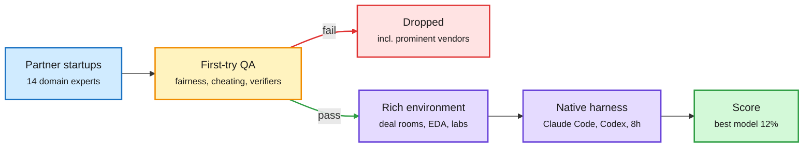

# GDPx: SemiAnalysis benchmarks frontier agents where the money is (best model 12%)

**Source:** SemiAnalysis (Max Kan), "GDPx: Measuring Frontier Model Capabilities Across the Most Valuable Domains", 2026-11-02
**Links:** [Post](https://newsletter.semianalysis.com/p/gdpx-measuring-frontier-model-capabilities) · [Leaderboard](https://gdpx.semianalysis.com/)
**Raw:** `raw/rss/2026-11-02-semianalysis-gdpx-measuring-frontier-model-capabilities-across-the-m.md` (also in `raw/gmail/2026-11-02-newsletters.md`)

## TL;DR

GDPx is a general agentic benchmark built around the domains SemiAnalysis expects to produce the first trillion dollars of AI revenue, not around share of GDP or the O*NET job taxonomy. Eleven domains (chip design, cybersecurity, biology, finance, legal, quant trading, recursive self-improvement, hardware design, materials science, alignment, software engineering) come from 14 specialized RL-environment startups, each of which had to pass SemiAnalysis's automated QA on the first try. Every task ships with a realistic environment (a ~4,000-file M&A deal room, live multi-service cyber ranges with proprietary zero-days, simulated labs with TEMs and battery cyclers, live Siemens NX sessions, real AWS FPGAs, Nangate45 physical-design flows) and up to 8 hours. The best model scores 12%. Opus 5.5 is the best all-rounder (wins quant, hardware and chip design); Gemini 4 Carbon is the only model in the same ballpark as Opus and GPT-6 Astra; Astra wins recursive self-improvement and materials. Finance and legal are near 0 under binary grading. The post argues OpenAI's GDPval (09-2025) is obsolete because its tasks spoon-feed context and lack environments.

The environment, not the prompt, is where the difficulty lives

GDPval hands the model its context; GDPx makes the agent go find it.

Blue is the task source, amber is the QA gate, red is rejected vendors, purple is the run, green is the score.

## Key findings

- **Headline:** best model 12% (pass@1 over three attempts, domains weighted equally). Safety classifiers sandbag Opus 5.5 and GPT-6 Astra on cyber, bio and alignment; excluding those three domains changes the ranking. Muse Wonder Full is the best available cyber model "by a meaningful margin" because its classifiers trigger less.
- **Spikiness:** leading models win different domains, and models within one family share the same spikes. Dylan Patel later posted an "official apology to Google": Carbon is "spikier" but very strong in a few areas.
- **Cost frontier:** Luna and DeepSeek fight for the low end, Opus owns the high end, OpenAI claims the middle.
- **QA claim:** the same automated QA flags nearly 50% of Terminal-Bench 4.0 tasks as broken. Partners who needed multiple QA rounds were dropped, because a task that passes after 3-4 rounds may have learned to fool the QA.
- **Chip design is over-weighted on purpose** (three partners: Aria, Arcverex, Ergodex). SemiAnalysis expects AI spend on chip design to ramp in 2027, "the next killer app after coding". Tasks: DV regressions graded on separating correct from buggy implementations (including bugs that shipped in real chips), bit-exact RTL plus PPA optimization, a black-box "Tensor Graph Machine" accelerator scored by EDAP (energy × delay × area) against an expert reference with full Nangate45 sign-off, and a timing-repair ECO on an Ibex RISC-V core (at most 104 of 20,702 cells changed). Observed failures: correctness collapses under PPA pressure, models iterate locally instead of revisiting architecture, and they misbudget slow simulation/synthesis/layout runs.
- **RSI tasks** (Extrapolate, ex-xAI RSI team) include debugging a broken large-scale RL run, data curation, and KV-cache optimization inside inherited frontier-lab codebases.
- **Quant:** across 111 graded runs on the IEX order-book tape, 70 did worse than the reference strategy they were asked to beat; models confuse taking more risk with finding edge and overfit execution thresholds.

## How it relates to prior wiki pages

- **Extends the measurement-crisis thread.** [Benchmark as empirical measure over difficulty (11-01)](../llms-foundation-models/2026-11-01-air-schedule-unified-training-benchmark-measure.md) showed 25 benchmarks overweight some difficulty bands; GDPx's "50% of Terminal-Bench 4.0 is broken" claim is the stronger, vendor-side version of the same complaint. Kepler (10-04) found public ARC-AGI-3 scores saturated by runs that read the game source. Three independent signals in a month that public agent benchmarks no longer discriminate.
- **Confirms verification as the bottleneck.** Aria reports that a model's chip-design ability correlates with its ability to write comprehensive testbenches, the same "verifier quality decides outcome" finding as Siemens' NeMo Gym verifier (11-01, ~55% to ~95% on a chip-design agent) and VerifierBench (10-23).
- **Native-harness evaluation.** Running each model in its own harness (Claude Code, Codex, Antigravity) makes GDPx a model+harness score, consistent with [agent harness engineering](agent-harness-engineering.md)'s view that the harness is part of the system under test.
- **Caveat:** partners are commercial RL-environment vendors who sell to the same labs being scored, and SemiAnalysis ties domain selection to a paid demand model. Treat GDPx as a strong, interested benchmark.

See [agent benchmarks](agent-benchmarks.md).
