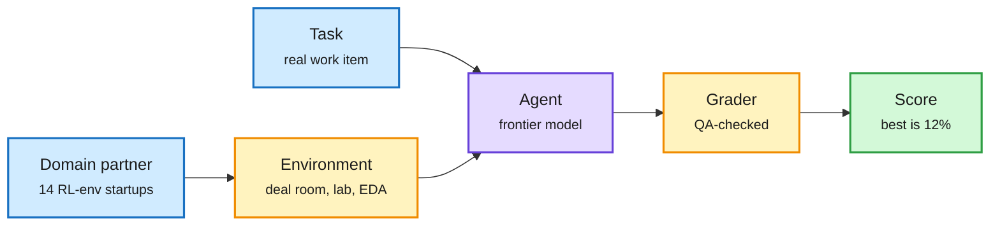

# GDPx: SemiAnalysis's benchmark for the domains where frontier AI makes money

**Source:** SemiAnalysis, "GDPx: Measuring Frontier Model Capabilities Across the Most Valuable Domains" (2026-11-02)
**Links:** [Post](https://newsletter.semianalysis.com/p/gdpx-measuring-frontier-model-capabilities) · [Hassabis reply](https://x.com/demishassabis/status/2117142448577093706)
**Raw:** `raw/rss/2026-11-02-semianalysis-gdpx-measuring-frontier-model-capabilities-across-the-m.md`, `raw/gmail/2026-11-02-newsletters.md`

## TL;DR

SemiAnalysis argues the first trillion dollars of AI revenue will concentrate in a few high-ROI sectors, so a general agentic benchmark should weight those sectors, not GDP share or occupation taxonomies. GDPx covers chip design, cybersecurity, biology, finance, legal, quant trading, recursive self-improvement (RSI), hardware design, materials science, alignment and software engineering, and skips government, real estate and insurance. Tasks were built with 14 RL-environment startups (for example Aria, Arcverex and Ergodex for chip design; Arithmetic for cyber; Living Context for finance) and each task ships a realistic environment: a ~4,000-file PE deal room, live services with real zero-days, simulated labs with battery cyclers and a TEM, live Siemens NX sessions and real AWS FPGA instances. The best model scores just 12% (pass@1 over three attempts).

The environment is the benchmark

GDPval spoon-feeds context in the prompt; GDPx makes the agent go find it.

Blue is inputs, amber is the environment and grader, purple is the model, green is the result.

## Key results

- **Opus 5.5** is the best all-round model and wins quant trading, hardware design and chip design.
- **Gemini 4 Carbon** is the best bio model (likely weaker safety classifiers) and edges software engineering; the only model near Opus and GPT-6 Astra.
- **GPT-6 Astra** wins RSI and materials science.
- **Finance and legal:** almost every model scores exactly 0.
- **Safety classifiers sandbag scores** for Opus 5.5 and Astra in cyber, bio and alignment; excluding those domains changes the ranking. Muse Wonder Full is the best cyber model by a margin.
- **Cost-performance frontier:** Luna and DeepSeek at the low end, OpenAI in the middle, Opus at the top.
- **Critique of GDPval** (OpenAI, Sept 2025): tasks are non-interactive with context spoon-fed in the prompt; rubric graders with 71% human inter-rater agreement; broken rubrics, wrong gold solutions, stale links.

## Relation to prior wiki pages

- **Extends** the [agent benchmarks concept page](agent-benchmarks.md) and the "benchmarks as measures" thread from [11-01](../llms-foundation-models/2026-11-01-air-schedule-unified-training-benchmark-measure.md), which argued benchmarks over-weight some difficulty bands. GDPx deliberately over-weights domains by expected revenue, an explicit choice of measure.
- **Confirms** [Optima cost-per-task benchmarking (08-16)](../ai-routing/2026-08-16-optima-cost-per-task-benchmarking.md): spiky per-domain winners plus a clear cost frontier is exactly the condition under which routing by domain pays.
- **Connects** to [agent training environments](agent-training-environments.md): the benchmark is a by-product of the RL-environment startup economy (labs pay $5K+ per high-quality task).

## Gaps

- SemiAnalysis also sells the revenue demand model the domain choice is based on; the weighting is a thesis, not a neutral measure.
- Several partners also sell RL environments to the labs being measured; contamination controls are described in the post's methodology but not independently audited.
