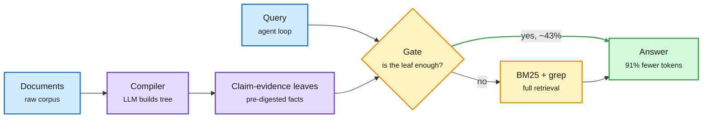

# Context as Infrastructure: knowledge compilation for agentic retrieval

**Source:** [arXiv:2610.41172](https://arxiv.org/abs/2610.41172) (RAGFlow team, InfiniFlow), surfaced by DAIR.AI on X ([thread](https://x.com/dair_ai/status/2117274289154252866)) · raw: `raw/twitter/feed/2026-11-02-evening-230005-ranked.json`

## TL;DR

A search harness with only BM25 and grep on MiniMax M3 answers 85% of BrowseComp-Plus and 91% of FRAMES without vector or compiled indexes. Accuracy is largely solved; context cost is not, because the loop repeats queries and rereads documents. Knowledge compilation (summary trees, PageIndex-style outlines, wikis, graphs) gave no detectable FRAMES accuracy gain, and the outline degraded at scale. Its value is as a supply layer: a navigation tree with claim-evidence leaves cuts query tokens 91% when the leaf suffices (~43% of queries) and adds 1.9% when it does not, a 38% average reduction with a 2% break-even sufficiency rate. Savings cost retrieval rounds (tokens halved, latency ~3x on one subset); a decision gate cut latency from 140 s to 30 s.

Compile the knowledge once, hand the agent the smallest sufficient set

The tree saves tokens only when its claim-evidence leaf is enough; a gate caps the latency cost.

Blue is input, purple is the offline compilation, amber is the online decision and fallback, green is the answer.

## Relation to prior wiki pages

- Extends [agent harness engineering](agent-harness-engineering.md): another harness result where measurement in tokens and latency matters more than accuracy, following DeepSeek Harness's reported 87.9% token cut (Tsinghua and Microsoft, circulating 11-02).
- Same lesson as the NVIDIA KV-cache infra post (11-02, [summary](../inference-efficiency/2026-11-02-kv-compression-paged-infra-problems.md)): savings only count in the unit the bill uses.
- Relevant to [agent memory](agent-memory.md): ontology, timeline and memory artifacts pay off in governance and continuity that benchmarks do not see.
- Counterpoint: Mixedbread (AI Engineer talk, 11-02) reports 36% to 98% accuracy from better multimodal late-interaction search on PDFs, where the OCR-chunk-embed stack loses information before the harness sees it.
