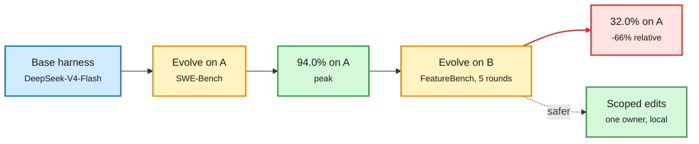

# Continual harness evolution forgets, and the day's harness papers

**Sources:** HuggingFace Daily Papers 2026-11-03 · [Can Coding Agents Sustain Continual Evolution without Forgetting? arXiv 2611.03219](https://arxiv.org/abs/2611.03219) · [LeanGuard 2611.02332](https://arxiv.org/abs/2611.02332) · [CoworkOS 2611.03178](https://arxiv.org/abs/2611.03178) · [CUA-Master 2611.03126](https://arxiv.org/abs/2611.03126) · [SWE-Trail 2611.02074](https://arxiv.org/abs/2611.02074) · X feed: [SPAR 2611.01695](https://arxiv.org/abs/2611.01695), [OpenVLHarness](http://openvlharness.github.io) · raw: `raw/huggingface/2026-11-03-*.md`, `raw/twitter/feed/2026-11-03-evening-210222-ranked.json`

**TL;DR.** A self-evolving harness (the code, prompts and tools around a model, rewritten by an agent from its own results) can climb very high on one benchmark. But it forgets when it keeps evolving on something else. The THU study arranges three software-engineering datasets into six evolution orders and runs two harness-evolution methods along each. With DeepSeek-V4-Flash, Meta-Harness evolves to 94.0% on SWE-Bench. After further evolution on FeatureBench, it falls to 32.0% on SWE-Bench by round five, a 66% relative drop. The harness is a shared global object, and global edits overwrite earlier competence.

Evolve on B and the harness forgets A

94% to 32% on SWE-Bench in five rounds of evolving elsewhere.

Blue is the start, amber is an evolution phase, green is a good state, red is forgetting.

## The day's other harness work

- **LeanGuard (2611.02332).** Every proposed tool call is checked against a policy written in Lean4 before it runs. Policies can refer to past actions (past-time temporal operators), and the check fails closed. On Tau-Bench with five Qwen models (0.8B-27B), unguarded agents ran 33+ forbidden calls and LeanGuard ran none, with no significant change in task success when it gives feedback. On DTap it cut prompt-injection success from 57.9% to 5.9%. Proof-guided repair found a provably allowed nearby call for 88 of 252 argument-value denials, with no model involved.
- **SPAR (Alibaba, 2611.01695).** A self-evolving B2B sales agent, tested in a live A/B test across 200,000+ merchants on 1688.com. Conversion rose 15.8% and high-intent merchant growth rose 35.8%. It works without weight updates. An inner loop keeps per-merchant episodic memory. An outer loop keeps a playbook of strategies written as testable hypotheses. The key step is *attribution*: before editing the playbook, it decides whether a lost deal came from a bad strategy or an outside factor.
- **CoworkOS (2611.03178).** A long-horizon harness that separates strategy from execution. The model decides actions, delegation and acceptance. The runtime keeps state, feedback, hierarchical workspaces and persistent memory. Humans and agents edit the same documents, CAD models and Blender scenes.
- **CUA-Master (2611.03126).** Computer-use agent data built with a double flywheel. Seeds are real workflows mined from instructional videos. These are expanded into verifiable synthetic tasks, and snapshot-rollback retries make rollout collection reliable. The 27B model is competitive.
- **SWE-Trail (2611.02074).** Uses earlier trajectories to decide *where* to spend more collection effort, but keeps that history out of the agent's context. That avoids training the model to rely on advice it will not have at test time.
- **OpenVLHarness (UCLA + Apple).** A visual agent harness with a capability layer and multimodal memory. Across 22 benchmarks it beats Codex and Visual Sketchpad, and it reports 63% lower token cost. Raising reasoning effort from xhigh to max cost 2.7x the tokens for +0.7 points, because more reasoning cannot invent missing visual facts.

## Relation to prior wiki

- **Confirms with a hard number** the 10-29 continual-learning study in [self-evolving agents](self-evolving-agents.md): ReasoningBank, GEPA and Meta-Harness trade stability for plasticity under drift because global prompt edits overwrite earlier knowledge. 94% to 32% is the starkest figure yet.
- **SPAR's attribution step** is the same guard as EMMA (10-29, one owner per self-edit) and RuHarness (10-30, the rubric co-evolves with the harness): do not write a lesson until you know what caused the outcome.
- **Token cost of harness vs thinking.** OpenVLHarness's "max effort buys 0.7 points for 2.7x tokens" matches the 11-02 DeepSeek Harness result (87.93% fewer tokens). Grounding through tools beats spending more reasoning tokens. See [agent harness engineering](agent-harness-engineering.md), [test-time compute allocation](../inference-efficiency/test-time-compute-allocation.md).
