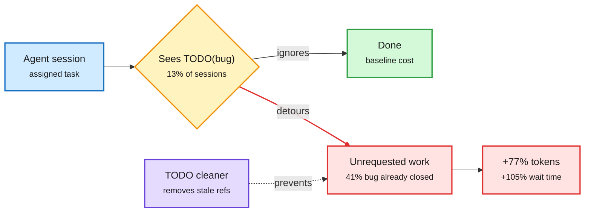

# Two lab field reports on agent behaviour

## Anthropic: "The components of agent memory"
[Post](https://www.anthropic.com/research/components-of-agent-memory). Memory works when the model *closes the loop*: writes a theory, tests it, and stores validated rules.
- **CL-Bench 1.0** (database Q&A, fresh session per question, persistent memory folder): Sonnet 4.6 left untested theories; Opus 4.7 consolidated notes into one reference; Sonnet 5 marked answers as confirmed; Opus 5 was first to store validated rules, and Opus 5.5 / Sonnet 5.5 do the same.
- **Pokemon Red at ~10K steps:** Sonnet 3.7 wrote 413 files in 225 folders and earned 1 badge (once spending 17 steps reorganizing memory with no game actions). Fable 5 wrote 9 files plus `global.md` and earned 4 badges. Opus 5.5 beat the game.
- **Steering:** telling the model what memory is *for* beats telling it *how* to use it. A "record only failures" rule erased much of the gain. Prompting Sonnet 4.6 to read memory and test theories nearly doubled its score. "Dreaming" (offline consolidation of session logs, after Letta/Berkeley sleep-time compute) is part of the recipe.

## Google: "Agent Distraction"
[Post](https://developers.googleblog.com/agent-distraction/). From hundreds of millions of internal agent steps: 13% of sessions see a `TODO(bug/...)` comment; 6% of those trigger work on the bug, and 83% of that work was never requested. 41% of detours chase bugs already closed. In a fixed-effects regression, a detour costs +70% steps, +77% tokens, +105% wait time per session. A TODO-cleaner agent removed thousands of stale references over six months with >95% reviewer acceptance.

A stale TODO is a token tax

The fix lives in the codebase, not in the model.

Blue is the task, amber is the decision point, red is the wasted path, purple is the fix, green is the clean path.

## Relation to prior wiki
- Both say the same thing as the 11-05/11-06 harness thread ([harness engineering](agent-harness-engineering.md)): agent cost is set by the environment the model reads (memory folder, codebase) as much as by the model. Google's +77% tokens is a cost number for "context hygiene."
- Anthropic's validated-rules finding pairs with EvoMemState ([shorts](../inference-efficiency/2026-11-09-efficiency-and-agent-shorts.md)) and Coca-Cola ([summary](2026-11-09-coca-cola-latent-tool-observation-compression.md)): what the agent keeps should be what changes its next action.

Concept pages: [agent memory](agent-memory.md) · [harness engineering](agent-harness-engineering.md)
