# Coca-Cola: tool observations as latent tokens

**TL;DR.** Agents normally paste raw tool output (search results, page text) into their context as text tokens. Coca-Cola (THU, [arXiv 2611.06500](https://arxiv.org/abs/2611.06500), [code](https://github.com/THU-Agent/Coca-cola)) trains a small compressor that turns each tool observation into a handful of continuous "latent tokens" placed directly in the agent's input-embedding space. The training signal is not reconstruction: Action-Preserving Training aligns the agent's next-action distribution under the full and the compressed observation, so the latents keep only what changes the agent's next move. On web-search agents across four QA benchmarks and two model families, agent token use falls 70.01-89.24% and end-to-end runtime 24.45-55.97%, while task accuracy rises.

```mermaid
flowchart LR
  T["Tool call<br/><small>search, fetch, API</small>"] --> O["Raw observation<br/><small>thousands of noisy tokens</small>"]
  O --> C["Compressor<br/><small>emits latent tokens</small>"]
  C --> A["Agent LM<br/><small>reads latents as embeddings</small>"]
  A --> N["Next action<br/><small>70-89% fewer tokens</small>"]
  O -.->|training only| F["Full-text agent<br/><small>reference action dist.</small>"]
  F -.->|match actions| C
  classDef input fill:#d0ebff,stroke:#1971c2,color:#1b1b1b,stroke-width:2px
  classDef core fill:#e5dbff,stroke:#6741d9,color:#1b1b1b,stroke-width:2px
  classDef loop fill:#fff3bf,stroke:#f08c00,color:#1b1b1b,stroke-width:2px
  classDef exit fill:#d3f9d8,stroke:#2f9e44,color:#1b1b1b,stroke-width:2px
  class T,O input
  class C loop
  class A,F core
  class N exit
  linkStyle 3 stroke:#2f9e44,stroke-width:2px
  linkStyle 5 stroke:#f08c00,stroke-width:2px
```

The tool output never enters the context as text

A compressor sits between the tool and the agent; it is trained on what the agent does next, not on what the page said.

Blue is the tool side, amber is the compressor, purple is the agent model, green is the cheaper result.

## Key points
- **Discrete compression hits a ceiling.** Pruning and summarization still emit text tokens, so ratios stay modest. Continuous latents break that ceiling.
- **Action-sufficiency is the objective.** The compressor is trained to preserve the next-action distribution (a KL between full and compressed contexts), not to reconstruct the page. Information that does not change behavior is dropped.
- **Numbers:** 70.01-89.24% fewer agent tokens, 24.45-55.97% lower runtime, accuracy up on all four QA benchmarks and both model families.
- **Cross-source:** on HuggingFace (11-07 list) and Kurate cs.AI #18 (ai_rating 5.5).

## Relation to prior wiki
- **Extends** NVIDIA's "You don't need long context" (2611.05306, [11-05](../inference-efficiency/2026-11-05-context-budget-compaction-and-context-rot.md)), which showed frequent compaction costs frontier agents almost nothing (SWE-bench 70.2 vs 70.0). That work compacts in text; Coca-Cola compacts below text.
- **Same idea as SwarmEvolve the same day** ([summary](2026-11-09-swarmevolve-latent-kv-swarms.md)): agents exchange latent state instead of decoded tokens. Third paper in a week moving agent communication off the token channel (with PACT/PLatour, [shorts](../inference-efficiency/2026-11-09-efficiency-and-agent-shorts.md)).
- **Cost link** to the SIMPLE Law ([11-06](../inference-efficiency/2026-11-06-simple-law-energy-cost-inference.md)): the KV term, not prefill, dominates agent energy. Shrinking observations shrinks the KV term directly; caching does not.

## Gaps
Only web-search QA agents. No coding agents, no long-horizon tasks where an observation is needed again many turns later, and latents are model-specific, so a compressor must be retrained per agent backbone. No test with closed API models, which cannot accept embeddings.

Concept pages: [agent memory](agent-memory.md) · [KV cache](../inference-efficiency/kv-cache.md) · [harness engineering](agent-harness-engineering.md)
