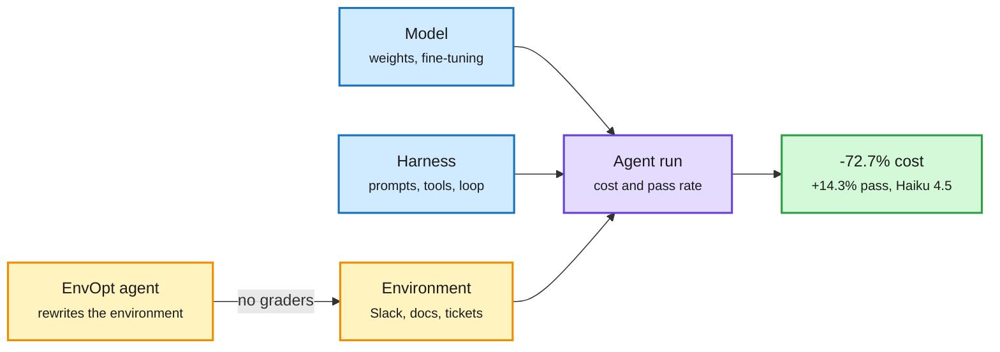

# EnvOpt and agent-cost shorts

## EnvOpt (Berkeley Sky)
[arXiv 2611.07372](https://arxiv.org/abs/2611.07372). An agent's cost and success depend on model, harness, and **environment**. EnvOpt optimizes the third: the stationary workspace many tasks share (a Slack, a doc set, a ticket system). A coding agent rewrites how information is represented in that environment, using real or synthetic tasks with no graders, and stops on a validation set. On AutomationBench, Claude Haiku 4.5 gets 72.7% cheaper and +14.34% pass rate. The same optimized environment transfers to Opus 5 (-68.1% cost, +1.34%). On top of Meta-Harness's optimized harness it cuts another 83.4% and adds 11.17%. One optimization run costs about $150.

Three levers on agent cost, and the third was untouched

EnvOpt edits what the agent reads, not the agent.

Blue is the two studied levers, amber is the new lever, purple is the run, green is the measured result.

## Shorts
- **Evolver** ([2611.07595](https://arxiv.org/abs/2611.07595)): stores reusable procedural "Gene" assets for Claude Code and Codex; success 83.13% to 87.50%, tokens -24.24%. The 320-run eval set was selected for diagnosis.
- **ReproBridge** (Google, [2611.08452](https://arxiv.org/abs/2611.08452)): saved, refined reproduction artifacts lift agent paper-reproduction success 76.4% to 92.6% and cut API spend 19.7%; best-to-worst model gap narrows 21.6 to 3.9 points.
- **MCPHallu** ([2611.07689](https://arxiv.org/abs/2611.07689)): 358 tasks on 36 production MCP servers; only 23.2% of unreachable-goal runs pass, because agents keep calling tools instead of saying the goal cannot be met.
- **Drex** (Nace AI, [2611.07854](https://arxiv.org/abs/2611.07854), also on HF 11-07): "decision models" score every supplied option in one forward pass instead of generating text. Drex Max is within 1.6 points of Opus 5.5 on Decision Bench v4 at 183ms vs ~3.5s. A cheap judge and router component.
- **Memorilla** (Stanford, [code](https://github.com/snap-stanford/memorilla)): 16 learned query-dependent memory tokens replace a full document for a frozen LLM; Qwen3-8B on FactKG 84.33% vs 80.43% full context with 108x fewer document tokens.

## Relation to prior wiki
- Google's agent-distraction post ([same window](2026-11-09-anthropic-agent-memory-and-google-agent-distraction.md)) measured +77% tokens from stale TODOs; EnvOpt automates the cleanup. Two independent sources say the environment is a cost lever.
- Pattern across the window: Coca-Cola, Memorilla, Route to Remember and EnvOpt all cut agent tokens by changing *representation* (latent, learned tokens, weights, rewritten environment) rather than summarizing text. See [harness engineering](agent-harness-engineering.md).
