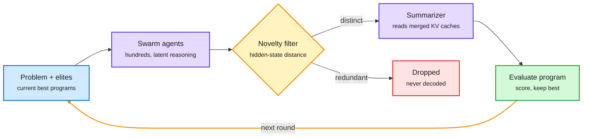

# SwarmEvolve

**TL;DR.** LLM-guided evolutionary search (the AlphaEvolve pattern: an LLM proposes program edits, the best survive and recombine) is slow because every candidate requires a long text chain of thought, repeated many times to keep the population diverse. SwarmEvolve ([arXiv 2611.08483](https://arxiv.org/abs/2611.08483)) runs hundreds of cheap agents per round that reason in latent space without decoding text. Diversity is enforced by a novelty filter on hidden-state distances. Crossover happens by handing a summarizer agent the concatenated KV caches of a swarm. On 21 math-discovery and scientific-computing problems it gets the best average score and reaches other frameworks' 60-minute best in a median 3-8 minutes. With Qwen3-8B it beats some solutions AlphaEvolve first found with frontier models.

Ideas travel as KV caches, not as text

Decoding only happens once per swarm, at the summarizer.

Blue is input, purple is model work, amber is the diversity gate and loop, green is evaluation, red is discarded work.

## Key points
- Cost comes from decoding. Removing per-agent decoding makes a 100-agent round cheaper than a few text agents.
- Diversity is measured, not prompted: distances between hidden-state vectors replace "be creative" prompting.
- KV-cache concatenation is the crossover operator.
- Small open model (Qwen3-8B) matches or beats frontier-model AlphaEvolve results on several problems.

## Relation to prior wiki
- Pairs with [Coca-Cola](2026-11-09-coca-cola-latent-tool-observation-compression.md) (tool output as latents) the same day: the token channel between agents is being replaced by a latent one.
- Cuts against AIMO-style findings that prompt diversity hits a ceiling: here diversity is enforced in representation space, which is a different lever.
- KV-cache sharing across agents is a serving question: caches must be co-resident to merge, which ties the method to [KV cache](../inference-efficiency/kv-cache.md) memory budgets.

## Gaps
Only open models with KV access. Wall-clock comparisons depend on hardware and batch packing. No ablation on how many KV caches a summarizer can merge before attention degrades.

Concept pages: [self-evolving agents](self-evolving-agents.md) · [multi-agent systems](multi-agent-systems.md)
