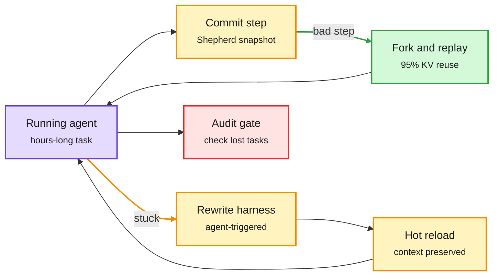

# BOXBOX, Shepherd, EvoAudit and HEELO: the harness becomes a live, versioned runtime

**Date:** 2026-11-10 · **Sources:** BOXBOX ([arXiv 2611.09218](https://arxiv.org/abs/2611.09218), via [@dair_ai](https://x.com/dair_ai/status/2119886501421167042)) · Shepherd ([repo](https://github.com/shepherd-agents/shepherd), via [@akshay_pachaar](https://x.com/akshay_pachaar/status/2119783946204672434)) · Beneath the Surface / EvoAudit ([arXiv 2611.07624](https://arxiv.org/abs/2611.07624)) · HEELO agent-native primitives ([arXiv 2611.07461](https://arxiv.org/abs/2611.07461)) · raw: `raw/twitter/feed/*-ranked.json`, `raw/huggingface/2026-11-09-beneath-the-surface-*.md`, `raw/huggingface/2026-11-09-the-last-mile-*.md`

## TL;DR

- **BOXBOX** (Microsoft and others) moves harness optimization *into* the run. Offline harness tuning needs tasks with reference answers; long open-ended runs hit problems the tuned harness never saw. In BOXBOX the agent decides when to revise its own harness, and a kernel hot-reloads the new version while keeping the full execution context, so nothing restarts. On PerfRace (a new benchmark for long-running software performance optimization) it reaches 1.70x Speedup@4h vs 1.54x for the best baseline (frozen harness, offline Harness Evolution, or Harness Scaling), at matched test-time budget and lower model cost.
- **Shepherd** (Stanford) records each agent-environment step as a copy-on-write commit of process plus filesystem. Rewinding a bad step is one fork, about 5x faster than `docker commit`, with about 95% KV-cache reuse on replay because the prompt prefix is unchanged. A meta-agent on top raised two-agent CooperBench pass rate from 28.8% to 54.7%. 2.5K GitHub stars in days.
- **Beneath the Surface** audits harness evolution, the route to recursive self-improvement without weight updates. All 16 evolved agents gained new tasks while losing previously solved ones. Most reliability gains also raised deployment cost. The top-scoring evolved agent never gave the largest mean improvement. EvoAudit turns these checks into revised select/analyze/mutate/gate steps.
- **HEELO** builds harnesses from "agent-native primitives": reusable units that pair a resource with a resident LLM that knows how to apply it. Terminal-Bench 4.0 rises from 37.3% (Codex) to 55.5% on the same backbone.

Revise the harness mid-run without losing the run

BOXBOX edits forward, Shepherd rewinds backward; both keep the context alive.

Purple is the agent, amber is harness change, green is cheap recovery, red is the regression check EvoAudit says is missing.

## Relation to prior wiki pages

- **Extends** the [agent-harness-engineering](agent-harness-engineering.md) evolution wave (10-22 onward), which tuned harnesses offline between runs. BOXBOX is the first wiki result that edits the harness inside one ongoing run with context kept.
- **Contradiction:** "The End of Harness Engineering" (circulating the same day: a 4B model proposes eight harness edits and keeps only the best on held-out questions) assumes held-out score is the right selector. Beneath the Surface finds the top scorer is never the best improver and every evolved agent forgets tasks. Both can be right only if the scoring set measures coverage, not just pass rate.
- **KV cache angle:** Shepherd's 95% replay reuse turns prefix caching into a rollback primitive. See [kv-cache](../inference-efficiency/kv-cache.md).
- **Kernel angle:** PerfRace is performance optimization; Evolving Agent Teams (same day) is GPU kernel optimization. Both find fixed agent setups plateau and gain from restructuring mid-run.
- Concept: [self-evolving-agents](self-evolving-agents.md).

## Gaps

BOXBOX's 1.70x vs 1.54x is one benchmark the authors built. Shepherd cannot undo external side effects (sent email, paid API calls). HEELO's eight primitive families are hand-designed seeds.
