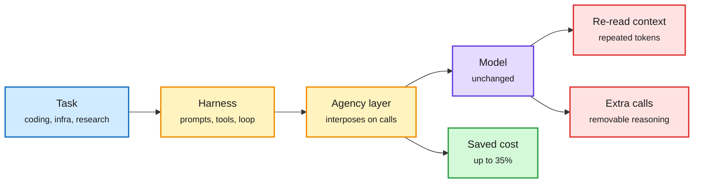

# The agent bill is set by the harness

## TL;DR

Five papers in one window measure where an agent's money goes, and they converge. **Agency** (Berkeley, [2611.12122](https://arxiv.org/abs/2611.12122)): harness choices like system prompts and tools barely move accuracy, but change cost by up to 2.6x on the same model and task. Tracing agent runs, the authors find five cost patterns, each either re-reading context or making extra LLM calls. Agency is an interposition layer between existing harnesses (Claude Code, Codex) and the model, so one optimization works across harnesses; five proof-of-concept techniques cut cost up to 35% without accuracy loss. **How Do AI Agents Waste Your Money?** (UIUC/Northeastern/UCLA, [2611.07238](https://arxiv.org/abs/2611.07238)): an LLM judge marks removable spans in agent traces, and each claim is verified by actually removing those tokens and resuming execution. Removing 41 to 46% of reasoning largely preserves task performance on two agent benchmarks. Waste varies more across tasks and harnesses than across models. **Infrathon** ([2611.11995](https://arxiv.org/abs/2611.11995)): 150 runs of six models with 24-hour budgets on real AI-infrastructure optimization tasks, over 10,000 GPU-hours. Model rankings change with the horizon, and 135 of 150 runs keep improving in the second half. Claude Opus 5.5 raised a KV-cache compression ratio from 6.82% with the human-designed Quant-VideoGen codec to 19.86%. **InfraRSI** (Peking University, [2611.11558](https://arxiv.org/abs/2611.11558)): a harness that locks a task contract over workload, loss and timing so agents cannot fake speedups, then co-optimizes launch knobs and code patches with fitted time and memory models across all trials including OOMs. Mean MFU (model FLOPs utilization) rose from 17.4% to 30.0%, up to 2.75x, across four dense and MoE training workloads. **Parallel agent teams** (Duke/Princeton/Modal, [2611.09798](https://arxiv.org/abs/2611.09798)): with a 27B model and a 100-agent budget, ten teams of ten beat 100 independent agents on 10 of 12 long-horizon tasks (GPU kernels, formal proofs, exploits), and beat one team of 100 everywhere it was run.

Same model, same task, up to 2.6x different bill

The money leaks in two places: context re-read every call, and calls that did not need to happen.

Blue is the task, amber is the harness and the new layer, purple is the model, red is where cost leaks, green is what Agency recovers.

## Also in the cluster

- **What the Middleman Delivers** ([2611.07650](https://arxiv.org/abs/2611.07650), Queen's University, DAIR pick): of 20 third-party API relays reselling GPT-6 Astra and Claude Opus 5, five reported 4,200 to 60,000 more input tokens than the official API for identical requests, and four returned tool calls when tools were disabled. Token counts are now an audit surface.
- **HarnessFlow** ([2611.06254](https://arxiv.org/abs/2611.06254), DAIR pick): MCTS over complete harness codebases with a coding agent as the editor. 69.48% mean over six benchmarks, 3.95 points above Meta-Harness at lower per-task cost.
- **When Instruction Files Go Stale** ([2611.09802](https://arxiv.org/abs/2611.09802), DAIR pick): a stale test command in AGENTS.md cost Claude Sonnet 5.5 about two extra tool calls per run and silently "passed"; no agent repaired the file.
- **ByteAsk** (product, via @rohanpaul_ai): a C/C++ agent that maps where a fix belongs before the model reads code cut pooled tokens from 1,795K to 395K per run (-78%) and cost 68.1%, fixing the same bugs. Vendor numbers.
- **LongCapHarness** ([2611.10463](https://arxiv.org/abs/2611.10463), Microsoft): a GPT-5.6-Sol-written harness adds 64.18 points to Llama3-8B on long-context benchmarks with no training, at under half the cost of training-based baselines.

## Relation to prior wiki

- **Confirms the [agent harness engineering](agent-harness-engineering.md) thesis** at its strongest yet: "agent = model + harness", and the harness owns cost. The 11-05 [context-budget compaction](../inference-efficiency/2026-11-05-context-budget-compaction-and-context-rot.md) page and NVIDIA's "You don't need long context" (11-07, peak context 32K to 8K with no SWE-bench loss) attacked the re-read leak; Agency and the waste paper now measure it directly.
- **Pattern, five instances: agent + trusted checker optimizes a real system.** InfraRSI's contract, Infrathon's 24-hour benchmark, [Evolving Agent Teams (11-10)](../hardware/2026-11-10-evolving-agent-teams-and-relative-position-kernels.md), AlphaProof Code and Google's Lean quantum programs ([summary](2026-11-11-verified-optimization-alphaproof-code-lean-quantum.md)). The checker is what turns spend into real speedup.
- **Routing link.** Parallel agent teams is a test-time-compute allocation result: many small teams balance a high mean with variance gain. See [test-time compute allocation](../inference-efficiency/test-time-compute-allocation.md).

## Gaps

Agency's five techniques are proofs of concept, not a released product. The waste paper's judge marks spans, but online pruning was verified on only two benchmarks. Infrathon's KV-compression gain is on one video codec task.
