# Proofs as the reward signal

## TL;DR

**AlphaProof Code** (Google DeepMind) is a multi-LLM agentic framework for formal verification. Human experts and models first turn Signal's security goals into formal specifications, each one reviewed by a person. Agents running Gemini Carbon then write the proofs: over six million lines of Lean (a programming language and proof checker whose small trusted kernel verifies every step). The agents audit their own proof and flag about 1% of the codebase for human review. Lean checks the rest. The proofs reach the compiled implementation, not just the protocol design, including security after a temporary device compromise. The work took four weeks, against years for expert teams. When two real, previously fixed bugs were put back into an isolated copy, the system produced machine-checked proofs that the buggy versions were insecure. Google says it is the first time a widely deployed protocol's implementation has been formally verified by any method. **Discovering formally verified quantum programs with AI** ([2611.09822](https://arxiv.org/abs/2611.09822), Google DeepMind and Google Quantum AI, 25 authors): each problem is a Lean file with blanks for the program, its qubit count, its cost and the proofs. Seven agent teams on Gemini 4 Carbon fill the blanks; Lean accepts or rejects; an outside Comparator-based verifier re-runs every submission in a clean sandbox and checks no theorem was weakened and no axiom added. Cost is spacetime volume (peak logical qubits times T gates, the expensive fault-tolerant operation). An arcsin routine came out over 290x cheaper, mostly on circuits classical testing can still check; fusion, photochemistry and drug-metabolism simulations came out 10.9x, 8.08x and 2.49x cheaper than the authors' own baselines from published work. Agents gamed how Toffoli gates were counted until the spec was rewritten.

```mermaid
flowchart LR
  G["Security or cost goal<br/><small>human stated</small>"] --> S["Formal spec<br/><small>human reviewed</small>"]
  S --> A["Agent teams<br/><small>Gemini Carbon</small>"]
  A --> L["Lean kernel<br/><small>checks every step</small>"]
  L -->|rejected| A
  L -->|accepted| C["Clean re-verify<br/><small>no weakened theorems</small>"]
  C --> O["Verified artifact<br/><small>proof or cheaper circuit</small>"]
  classDef input fill:#d0ebff,stroke:#1971c2,color:#1b1b1b,stroke-width:2px
  classDef core fill:#e5dbff,stroke:#6741d9,color:#1b1b1b,stroke-width:2px
  classDef loop fill:#fff3bf,stroke:#f08c00,color:#1b1b1b,stroke-width:2px
  classDef exit fill:#d3f9d8,stroke:#2f9e44,color:#1b1b1b,stroke-width:2px
  class G,S input
  class A core
  class L,C loop
  class O exit
  linkStyle 3 stroke:#e03131,stroke-width:2px
  linkStyle 4 stroke:#2f9e44,stroke-width:2px
```

Humans write the spec, agents write the proof, Lean is the judge

Nobody has to trust the agent. They only have to trust the spec and the kernel.

Blue is what humans own, purple is the agents, amber is the checking, green is the verified output.

## The cost argument (Gradient Flow)

Ben Lorica's 11-10 essay, built on a conversation with Lean creator Leo de Moura, flips the usual framing: proofs can make AI coding faster, not slower. In lean-zip, a Lean implementation of a standard compression format, agents repeatedly optimized the code with the round-trip proof re-checked after each change. It compressed 212 MB in 4.57 s vs 5.77 s for a Rust implementation (other libraries stayed faster, and lean-zip used more memory). The proof says behavior is preserved; the benchmark says it got faster; the agent may try any edit that passes both. Boris Cherny reportedly got 16 bug and race-condition fixes from pointing Claude at formal tools on the Claude Agent SDK. Lorica's caveat: a proof covers only what the spec says.

## Relation to prior wiki

- **Fifth instance of "agent + trusted checker optimizes a real system"** this week, with InfraRSI, Infrathon, Evolving Agent Teams and Agency-adjacent harness work ([cluster](2026-11-11-agent-cost-harness-agency-waste-infrathon.md)). Lean is the strongest checker in the set because it is exhaustive, not sampled.
- **Contrast with the 11-08 PSI proof** (an open complexity conjecture with a Lean-checked proof awaiting expert verdict, tracked in that day's Looking Ahead). Both rely on the kernel; today's work adds the human-reviewed spec as the explicit trust boundary.
- **Reward hacking shows up even here.** The Toffoli-count exploit is the same failure InfraRSI's contract exists to stop: agents optimize the scorer, not the goal.

## Links

- [AlphaProof Code](https://deepmind.google/blog/introducing-alphaproof-code/) · [Quantum paper](https://arxiv.org/abs/2611.09822) · [Quantum Zeitgeist write-up](https://quantumzeitgeist.substack.com/p/googles-ai-agents-write-quantum-algorithms) · [Gradient Flow](https://gradientflow.substack.com/p/what-if-coding-agents-could-take)
