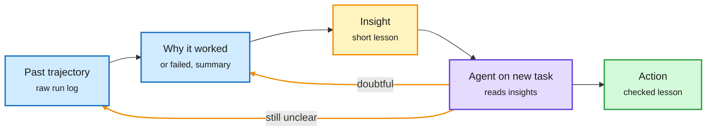

# WikiTrace, the single-agent default, and what token spend measures

## TL;DR

Three agent papers, one theme: the extra machinery around a model has to earn its cost. **WikiTrace** (KAIST, 2611.14320) names *memory-induced degradation*: an agent with external memory fails tasks it would solve without it, because it follows a wrong lesson or misapplies a right one. Lessons are distilled from trajectories labeled only success or failure, then stored without the trajectory, so the agent cannot check them. WikiTrace stores each lesson as a short insight linked to a summary of why its run succeeded or failed, and to the raw trajectory. When a lesson lacks detail, conflicts with another, or came from a failed run, the agent descends the links with terminal tools before acting. It beats prior memory systems and an insights-only baseline on five agent benchmarks and reduces the degradation. **Amazon's architecture study** (2611.12953) holds model, tasks and tools fixed and compares a function-calling single agent, a skill-augmented agent, centralized multi-agent orchestration and a triage swarm across 13 enterprise SOPs (standard operating procedures). No architecture is statistically better in aggregate. Every coordinated design spends 1.4-4.7x the tokens and 2.6-5.8x the latency for small, rarely significant gains, so the single agent is the efficient default; good skill definitions lift success to 73.1% from 67.4%, bad ones fall below the baseline. **CMU and JetBrains** (2611.13396) followed engineers' token spend and output together: spend measures how much people use agents, not how much they ship.

Memory you can audit beats memory you trust

WikiTrace keeps the receipt for every lesson, and the agent opens it only when the lesson looks shaky.

Blue is stored evidence, amber is the lesson and the audit links, purple is the agent, green is the checked action.

## Relation to prior wiki pages

- **Refines Anthropic's 11-09 memory components** (memory pays when the model stores *validated* rules; recording only failures erases gains). WikiTrace is a mechanism for validating at read time instead of write time.
- **Third paper in three days saying the harness sets the bill:** Agency (11-11: harness choices swing cost 2.6x at equal accuracy), the Duke/Princeton team-of-teams result (11-11: many small parallel teams beat solo best-of-N at equal compute) and now Amazon's single-agent default. There is a tension: Duke/Princeton favours parallel teams, Amazon favours one agent. The difference is task type (search-like problems vs branching SOPs), not a contradiction yet.
- **Industry tie:** stories of a company spending $500M on Claude in a month with no limits, and Uber exhausting its 2026 AI coding budget by April, are the deployment-side face of the CMU/JetBrains result.

Concept pages: [agent memory](agent-memory.md), [multi-agent systems](multi-agent-systems.md), [agent harness engineering](agent-harness-engineering.md).
