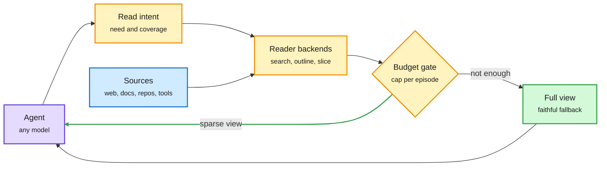

# SparseRead: read less, solve more

## TL;DR

Agents read whole web pages, files, repos and tool outputs when they need a few lines. That over-reading costs tokens and latency, and it dilutes the evidence the model needs. SparseRead is a layer that sits between the agent and its sources and decides what text is admitted, without touching the model. It has three parts: a Read Intent Protocol that tracks what the agent currently needs and what each source has already covered; Adaptive Reader Backends that pick how to locate and expose evidence (search, outline, slice); and a Budgeted Read Gate that caps the raw text exposed per episode, with a full-view fallback when the sparse view is not enough. Across six models (including Claude Opus 5) and five scenarios it cuts total tokens up to 92.9% and wall time up to 89.0%, preserving or improving quality in 97% of settings. On web deep-search it saves 31 to 43% of tokens and 23 to 37% of time.

The cheapest token is the one the agent never reads

A gate between the agent and its sources; the model is untouched.

Blue is the raw sources, purple is the agent, amber is the read-control layer, green is the fallback path.

## Key findings

- Token savings come from admission control, not compression: the agent sees less raw text, not a summary of it.
- The fallback keeps it faithful: when the sparse view fails, the full object is still reachable.
- Portable across three agent frameworks; no model changes.

## Gaps

- Savings are largest on scenarios with big objects; on deep search they fall to 31 to 43%.
- No breakdown of how much comes from prompt-cache interplay: a sparse view may break prefix caching that a stable full view would hit.

## How it relates to prior wiki pages

- **Extends** [agent harness engineering](agent-harness-engineering.md): the harness, not the model, controls context cost. It is the read-side cousin of context compaction (Microsoft's CompactionBench, mentioned the same day) and of AWS's Bedrock cost-per-task guidance naming agent-loop turns and verbosity as hidden cost drivers.
- **Connects** to the token-spend data in [agent memory](agent-memory.md) and the 11-12 WikiTrace page: CMU/JetBrains found doubling token spend buys about 10% more commits. Read control is one of the few levers that cuts spend without cutting output.
