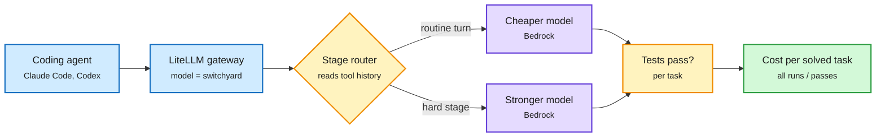

# Cost per solved task: routing inside the agent loop

## TL;DR

Three releases in one window treat the **task**, not the call, as the unit of cost.

- **NVIDIA NeMo Switchyard on Amazon Bedrock (AWS ML blog).** An open-source routing library, deployed as a LiteLLM plugin. *Stage routing* reads recent tool activity and results in the request history and picks one of two candidate models per turn; *random routing* does weighted splits for A/B tests. LiteLLM now ships a native Switchyard stage router as an auto-router strategy. The post's main argument: per-token price does not predict task cost, because task cost depends on turns needed, history replayed per turn, and retries or tasks that never finish. Judge routing by **cost per solved task** (total cost of all runs divided by runs whose tests pass). AWS ships benchmark runners for routed and single-model groups. switchyard-server 0.3.0 is labelled demo/evaluation.
- **Claude Code advisor tool.** `--advisor opus` (or `/advisor`, `advisorModel`) pairs a session model with a stronger advisor consulted only at checkpoints: before a plan locks, when an error repeats, before declaring done. Paired with `--fallback-model sonnet,haiku`, which drops a turn to a cheaper model when the primary is overloaded. Published list prices: Opus 5.5 $4/$20, Sonnet 5.5 $2/$10, Haiku 5.5 $0.10/$0.50 per million tokens.
- **Singularity-Bench (CMU, via @rohanpaul_ai).** Six end-to-end jobs (pre-training a model, building a serving engine, a cluster orchestrator and more), each scored against a production system on the same GPUs. Opus 5.5 in Claude Code scored a Singularity-Index of **1.25** (1.0 = human/production baseline); the other ten agents averaged 0.58. Its serving engine earned **$11.52 per GPU-hour against $8.18 for SGLang**. Paper link not captured; treat as a secondhand summary.

Also: **AsyncGRPOTrainer is stable in TRL v1.18.0**: RL generation and training run concurrently on separate GPUs instead of taking turns, so neither pool idles. And an OpenAI engineer's Codex agent ran 1,000+ hours over six weeks fixing CI across OpenAI (100+ PRs a week, 213+ merged fixes, 5,856 subagents, about $32/hour, $16 on the newer model).

The router reads the loop, not the prompt

Stage routing decides per turn from tool results; the score is cost per passing task.

Blue is the request path, amber is a decision, purple is a model, green is the metric that matters.

## Relation to prior wiki pages

- **Fifth "route by role inside the harness" example in two weeks** after Cohere's lead-plus-workers (11-08, ~70% cheaper), AgentBaton (11-10, capable-to-cheap handoffs cut 65.9%), Google's cost-per-task classifier routing (11-04) and the Carbon/Hydrogen Orchestrator (11-13, 24% less quota). Switchyard is the first one packaged as a vendor-neutral gateway plugin; see [llm-routing](../ai-routing/llm-routing.md).
- **Cost per solved task** is exactly the metric Google Cloud used on 11-04. Two hyperscaler-side blogs now say the same thing: token price is the wrong objective.
- **Singularity-Bench** connects to [agent-harness-engineering](agent-harness-engineering.md) and the RSI-for-infrastructure cluster (InfraRSI, 11-11, up to 2.75x training speedup; SGLang on IBM Spyre in under a week, 11-13). If the $11.52 vs $8.18 per GPU-hour holds, agent-written serving engines are not just catching up to SGLang, they are beating it on revenue per GPU on a specific workload.

## Open questions

- Switchyard's post ships no headline cost-per-solved-task number. The claim that stage routing wins is left to the reader's workload.
- Advisor checkpoints re-read the transcript with a larger model. How this interacts with prompt caching (cache is per model) decides whether it saves money in practice.
