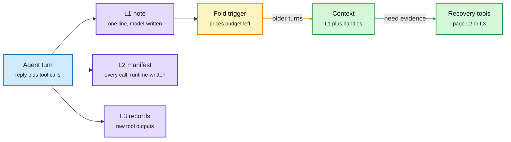

# Folio: recoverable multi-resolution context folding (2611.16627)

**TL;DR.** Long-horizon agents run out of context, and today's fix is to have the model summarize its own history. That costs a full reread and rewrite each time, and it throws detail away. Folio records three linked views of every turn while the agent runs: a one-line turn note the model writes as part of its normal reply (L1), a runtime-written manifest of every tool call (L2), and the raw captured records (L3). When the context fills, the runtime folds older turns down to coarser views in code, with no model call, and leaves handles that point to the finer views. Recovery tools let the agent page back into L2 or L3 only when it needs the evidence. On 75 LOCA-bench tasks with DeepSeek-V4-Pro behind every system, Folio solves 66 against 54 for the same runtime with model-written compaction and 49-59 for Claude Code, Codex and SoL-Pi, in about half the working time and at 2.4x lower cost. A fold takes a median 0.6 seconds.

Fold by picking a coarser view, never by rewriting

All three views are written as the agent works, so folding is a lookup and recovery is a handle.

Blue is the live turn, purple the three stored views, amber the fold decision, green what the model sees and how it gets detail back.

## Key claims
- Model-written compaction rereads and rewrites the history it replaces. Folio's fold is programmatic, because the coarse views already exist.
- The fold trigger prices an explicit "landing point" that includes the retained budget, instead of taking compaction output size as given (the gap in cache-aware triggers).
- 66/75 LOCA-bench tasks solved vs 54 (same runtime, model compaction) and 49-59 (Claude Code, Codex, SoL-Pi). About half the working time, 2.4x lower cost.

## Relation to prior wiki pages
- **Extends** [AKV (10-29)](agent-memory.md), which kept full text and edited only attention visibility, and the 10-28 "memory tax" finding that history rewriting drops facts. Folio keeps the full record outside the window and folds by resolution.
- **Closes a safety hole** flagged on the [responsible-ai page (09-17)](../responsible-ai/responsible-ai.md): a model-written compaction summary is a write channel into the agent's own future context. Folio's L2 and L3 are runtime-written, so the folded context is not model-authored.
- **Pairs with** [SparseRead (11-13)](2026-11-13-sparseread-token-efficient-reading.md), a harness-side read gate cutting tokens up to 92.9%. SparseRead controls what comes in; Folio controls what stays.

## Gaps
One benchmark (LOCA-bench, 75 tasks) and one backbone. No measurement of prefix-cache hit rate after folds, which decides the real serving bill.

**Source:** [arXiv 2611.16627](https://arxiv.org/abs/2611.16627) (Kurate cs.AI weekly list, 2026-11-15; `raw/kurate/2026-11-15-cs-ai.md`).
