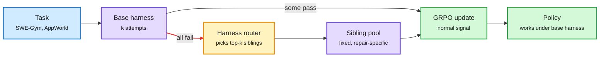

# Harness-S: learning from sibling harnesses (2611.04277)

**TL;DR.** A harness is the code around a model: tools, prompts, retries, state. Harness-S observes that harness variants grown from one base fix different failures (locality), cover for each other (complementarity), and change in usefulness as the policy learns (nonstationarity). So rather than searching for one best harness, it builds a fixed pool of sibling harnesses, each evolved along a different repair direction. During agent RL with GRPO (group-relative policy optimization, which scores a group of attempts against each other and learns nothing when all fail), the pool is used only when every base-harness attempt fails. An adaptive router picks the top-k siblings from behavior profiles and votes across several LLMs, the same policy retries there, and those trajectories replace the failed group. The skill then transfers back: under the original harness, Qwen3.5-4B on SWE-Gym goes from 24.38% to 38.75% pass@3. Results hold across AppWorld, SWE-Gym and DBBench, and reusing the router for Rank-1 inference adds gains at the same rollout count.

Pay for a second harness only where the first gave no signal

The router fires on all-failure groups, so extra rollouts go where GRPO would otherwise learn nothing.

Blue is the task, purple the harnesses, amber the router, green the learning signal and trained policy, red the failure path that triggers rescue.

## Relation to prior wiki pages
- **Router inside training.** The [llm-routing](../ai-routing/llm-routing.md) page tracks routers at inference. Harness-S puts a router in the RL loop, selecting environments rather than models.
- **Contrasts with** [Harness² (10-15)](2026-10-15-harness-and-environment-self-improvement.md), which edits the harness per task and keeps what helps at test time. Harness-S keeps the harness pool fixed and moves the capability into weights.
- **Fits** [BOXBOX (11-10)](2026-11-10-boxbox-shepherd-harness-runtime.md), mid-run harness hot-reload. Three ways to use harness variation: switch at run time (BOXBOX), edit per task (Harness²), distill into the policy (Harness-S).

## Gaps
The sibling pool is built from base-harness failures on the same benchmarks, so held-out transfer is limited. Rescue rollouts cost is not reported per solved task.

**Source:** [arXiv 2611.04277](https://arxiv.org/abs/2611.04277) · [code](https://github.com/DeepExperience/Harness-S) · surfaced via the X Following feed.
