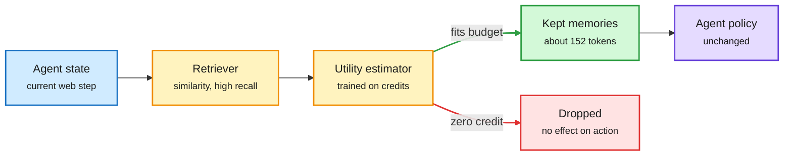

# MemCredit: from relevance to utility for decision-time agent memory (2611.15600)

**TL;DR.** Agent memory systems retrieve the memories most similar to the agent's current state. MemCredit (UESTC and NTU) asks whether those memories actually change what the agent does next. It measures each memory with a counterfactual intervention: run the decision with and without the memory and record how the action changes. Most retrieved memories have zero effect, and semantic similarity predicts usefulness poorly. Those measured credits train a small utility estimator. At inference, similarity only gathers a high-recall candidate set, and the estimator decides which candidates fit in a fixed token budget. The agent policy is untouched and no extra environment interaction is needed. On ALFWorld with a 500-token memory budget, success reaches 86.57% against 65.67% for BM25 retrieval (90.30% at 750 tokens), using 152.1 memory tokens per decision: 74.5% fewer than BM25 and 64.4% fewer than MemArbiter.

Similarity finds candidates, measured utility picks the keepers

The new box is a small estimator trained on "did this memory change the action?"

Blue is input, amber the two selection stages, green what is kept, red what is dropped, purple the frozen policy.

## Relation to prior wiki pages
- **Confirms** Anthropic's [components of agent memory (11-09)](2026-11-09-anthropic-agent-memory-and-google-agent-distraction.md): memory pays only when it stores what changes behavior (validated rules), not everything that looks related.
- **Complements** [WikiTrace (11-12)](2026-11-12-wikitrace-and-single-agent-default.md), which found memory can make agents worse when lessons lose their source trajectory. MemCredit gives a measurable test for "worse": zero or negative credit.
- **Same move as KV cache eviction**, on the [kv-cache](../inference-efficiency/kv-cache.md) page: decide which stored entries to keep by their effect on output, not by recency or similarity.
- DAIR Academy pick (Nov 11), amplified on X by @omarsar0.

## Gaps
Credits are policy-conditional, so a new backbone needs new interventions. Only ALFWorld and WebShop. The cost of computing credits offline is not compared with the tokens saved online.

**Source:** [arXiv 2611.15600](https://arxiv.org/abs/2611.15600) · [DAIR](https://academy.dair.ai/papers/memcredit-from-relevance-to-utility-for-decision-time-memory-in-long-horizon-web-2611.15600) · surfaced via the X Following feed (`raw/twitter/feed/2026-11-14-evening-*-ranked.json`).
