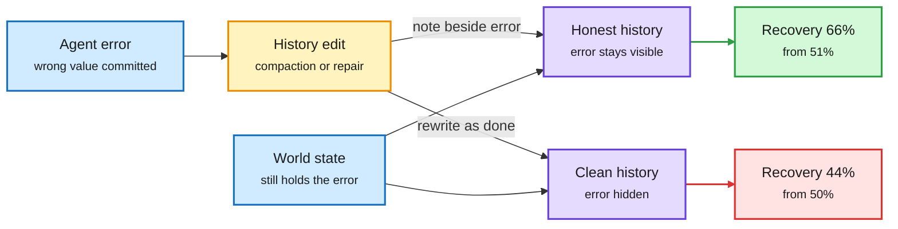

# A clean history can mislead the next agent

**TL;DR.** Salesforce AI Research (Egor Pakhomov, Shafiq Joty, Erik Nijkamp and colleagues) freezes tool-using agents mid-task with their exact world state saved. They then edit either the history or the world and let a receiver model continue. The only difference between arms is the edit. The same correct content can help or hurt depending on how the history states it. On AgentCE-Bench, after the agent commits a wrong value, adding the right value as a truthful note beside the preserved error raises recovery from 51% to 66%. Adding the same value as if the agent had completed it lowers recovery from 50% to 44%, worse than no edit. On AppWorld, a "success" receipt for a database write cuts whole-task success from 45% to 28% when the write's effect is absent, and raises it from 38% to 49% when it is present.

Compaction must agree with the world, not just look tidy

The same fix, written two ways, moves recovery in opposite directions.

Blue is the state you start from, amber is the edit decision, purple is the history the receiver reads, green helps, red hurts.

## Key findings

- **Form beats content.** A truthful note next to the preserved error: 51% to 66% recovery. The same value phrased as the agent's own completed action: 50% to 44%.
- **Receipts must match effects.** A success receipt with no actual effect: 45% to 28%. With the effect present: 38% to 49%. The 27-point interaction is positive in six of eight receiver models at 97.5% confidence.
- **Practical rule.** Test compaction, repair and handoff policies against the real world state.

## How it relates to prior wiki pages

- **Directly qualifies** [Folio](2026-11-15-folio-context-folding.md) (11-15, which folds agent history into coarser recorded views and ran 2.4x cheaper on LOCA-bench). Folio's views are recorded by the runtime, so they describe what happened. This paper shows what goes wrong if a fold or summary describes a cleaner world than the real one.
- **Confirms** the memory-tax result from 10-28 ([memory tax](2026-10-28-memory-tax-and-cheap-checks.md), where rewriting history dropped facts and scored below raw-history retrieval) and WikiTrace (11-12, which links each stored lesson back to its raw trajectory). Three papers now say the same thing: keep the evidence, annotate it, do not overwrite it.
- **Counterfactual method.** Freeze, edit one thing, continue. This is the same intervention design as [MemCredit](2026-11-15-memcredit-decision-utility-memory.md) (11-15, which values each memory by whether removing it changes the next action) and CoReMem (today).

## Gaps

- Two benchmarks and a handful of receivers. Long-horizon tasks with many errors, where compaction pressure is highest, are not tested.
- No proposal for an automatic consistency check between history and world. The rule is stated, not implemented.

## Links

- Paper: https://arxiv.org/abs/2611.14654
- Raw: `raw/dair/2026-11-16-123502-dair-academy.md`
- Concepts: [agent-memory](agent-memory.md) · [agent-harness-engineering](agent-harness-engineering.md)
