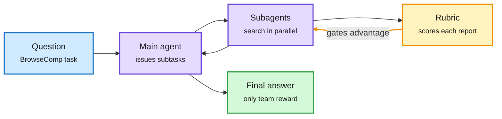

# LEAD-RL: credit each subagent by how useful its report was

**TL;DR.** Ant Group, UESTC, Zhejiang and Southeast University jointly train a main research agent and its subagents. The usual joint training gives every agent the same team advantage, so a misleading subagent report gets rewarded when the team happens to win. LEAD-RL scores each subagent report with a training-time rubric for research utility and uses that score to gate how much team advantage the subagent inherits. Final-answer correctness stays the only team reward. There is no token, step or speed reward. On BrowseComp it reaches 73.5%, 2.49 points above shared-credit joint training, and cuts critical-path cost from 323.3 to 244.2 steps per question (24.5%).

Delegation only pays after the team learns to coordinate

A rubric decides how much of the team's reward each subagent report deserves.

Blue is input, purple is the agents, amber is the training-time credit rubric, green is the result.

## Key findings

- 73.5% on BrowseComp, +2.49 over shared credit, with 24.5% fewer critical-path steps.
- **Swarm effect:** turning on subagents moved the untrained base model from 59.0% to 58.0%, while the trained system went from 66.5% to 73.5%. Delegation helps only after coordinated training.
- Efficiency fell out of better credit, not an explicit cost reward.

## How it relates to prior wiki pages

- **Confirms** the 11-12 "single agent is the right default" reading in [multi-agent-systems](multi-agent-systems.md) (WikiTrace digest): untrained delegation is neutral or harmful.
- **Credit assignment is the shared fix.** CoReMem (today) credits steps that used memory anchors. Harness-S (11-15) routes failed RL attempts to sibling harnesses. All three are about who gets credit inside an agent system.

## Gaps

- The rubric is a training-time judge. Its own biases transfer into the subagent policy, and that is not audited.
- Only "critical-path" steps are reported. Total tokens across parallel subagents, the real bill, are not in the abstract.

## Links

- Paper: https://arxiv.org/abs/2611.17041
- Raw: `raw/dair/2026-11-16-123502-dair-academy.md`
- Concepts: [multi-agent-systems](multi-agent-systems.md)
