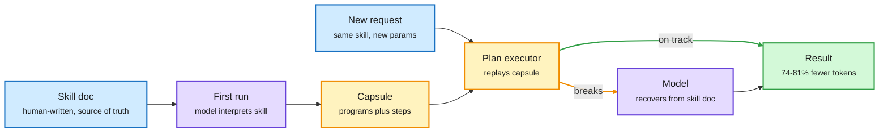

# SkillCache: compile a skill from one real run, then replay it

**TL;DR.** NVIDIA (Jiayi Ni, Zac Wang, Alex Zhang, Zheng Liu, Roopa Prabhu) asks how much of an agent skill's orchestration can be turned into an executable fast path. Compiling a skill before any execution fails. It used more tokens than plain skill use on 58 of 84 SkillsBench tasks (1.24x per task, geometric mean), because guesses about runtime bindings make plans brittle. SkillCache instead compiles one *completed* invocation into a parameterized "capsule" of programs and natural-language steps. A plan executor replays the capsule and hands control back to the model only when needed. The human-written skill stays as the fallback. In the Claude Code harness, warm runs cut tokens by 81% (Sonnet 4.6) and 74% (Opus 4.8) on 87 tasks at comparable reward. Capsules also transfer: three open-weight models gain 12-25 points of mean reward while using 72-81% fewer tokens.

The second run should not pay for the first run's thinking

One real trace becomes a replayable capsule. The model is only woken when the replay breaks.

Blue is input, purple is the model doing interpretation work, amber is the compiled fast path, green is the result.

## Key findings

- **Zero-shot compilation is a trap.** Compiling without execution evidence cost 1.24x the tokens of direct skill use and lost on 58 of 84 tasks.
- **One trace is enough.** Compiling from a single successful run cut warm-run tokens 81% (Sonnet 4.6) and 74% (Opus 4.8) on 87 tasks, at comparable reward, and held under controlled request changes.
- **Capsules are a transfer medium.** Three open-weight models gained 12-25 reward points and spent 72-81% fewer tokens running capsules a frontier model produced.

## How it relates to prior wiki pages

- **Confirms** the "deterministic steps beat more LLM calls" line in [agent-harness-engineering](agent-harness-engineering.md). It is the token-bill version of the claim that the best agent systems are mostly boring deterministic code.
- **Same family as** [Folio](2026-11-15-folio-context-folding.md) (11-15, which folds agent history by switching to views the runtime recorded rather than asking the model to summarize). Both stop paying the model to re-derive something the system already observed once.
- **Distillation without weights.** Capsule transfer to open models is a form of [knowledge distillation](../inference-efficiency/knowledge-distillation.md) through programs, not logits. Compare the 11-14 dspy-wsp prototype, where a frontier model edits a small model's weights directly.

## Gaps

- SkillsBench tasks are repeated, structured requests. Savings on open-ended work, where no two invocations share a plan, are untested.
- Capsule invalidation (when the environment or API changes underneath the capsule) is handled by fallback, but its failure rate over time is not measured.

## Links

- Paper: https://arxiv.org/abs/2611.10022
- Raw: `raw/dair/2026-11-16-123502-dair-academy.md`
- Concepts: [agent-harness-engineering](agent-harness-engineering.md) · [tool-calling](tool-calling.md)
