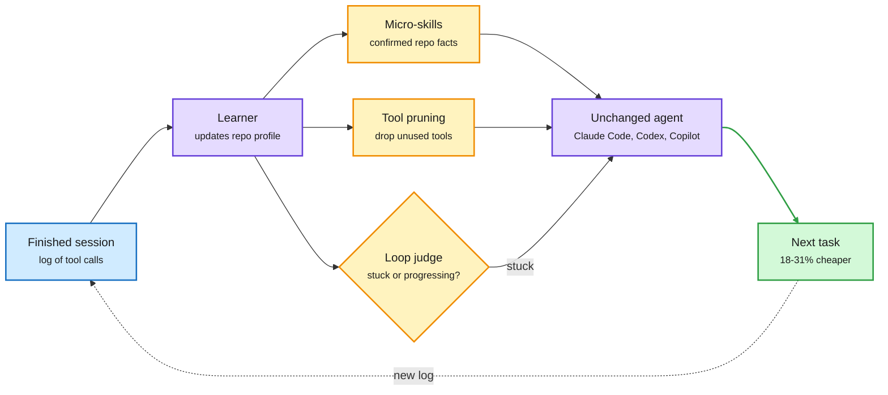

# TokenEconomizer: experience-driven black-box cost control for coding agents (2610.22732)

**Sources:** [Microsoft Research blog](https://www.microsoft.com/en-us/research/blog/tokeneconomizer-learning-from-experience-to-make-ai-coding-agents-more-efficient/) (2026-11-16) · [arXiv:2610.22732](https://arxiv.org/abs/2610.22732) · [github.com/microsoft/TokenEconomizer](https://github.com/microsoft/TokenEconomizer) · X amplification ([@rohanpaul_ai](https://x.com/rohanpaul_ai/status/2122466371594580269), [@CodeByNZ](https://x.com/CodeByNZ/status/2121906179588735472)) · raw: `raw/labs/2026-11-17-103427-labs.md`

## TL;DR

UC Berkeley, Microsoft Research and Microsoft Security profile where coding-agent tokens go when the same repository is worked on day after day. On 60 SWE-Bench tasks run in sequence with Claude Code, three kinds of waste recur. After five finished tasks in a repo, 30% of tool calls repeat an action from an earlier task in that repo (only 7% match another repo). The agent receives 23 tool descriptions every turn and never calls 16 of them. The 17% of tasks that fail eat 32% of the spend. TokenEconomizer is a plugin that reads each finished session's log and acts through interfaces the agent already exposes: **micro-skills** (one-line repo facts, added only after several sessions confirm them and retired if contradicted), **tool pruning** (drop tools history says won't be used, keep core shell and edit tools), and **failure-loop intervention** (a judge model decides if the agent is stuck; if so it gets a short redirect note, and the developer is alerted if it stays stuck). Across 277 SWE-Bench tasks in six repos with Claude Code, Codex and GitHub Copilot CLI, mean per-task cost falls 18.4-30.9%, savings hold in every repo, and Pass@1 improves in 4 of 5 agent-model settings. Reported savings include the plugin's own model calls. Three fixed-strategy open-source plugins each saved money in some repos and not others.

Each finished session makes the next one cheaper

The agent and model are untouched; only prompts and tool settings change.

Blue is the input log, amber is a learned intervention, purple is a component, green is the saving.

## How this relates to prior wiki pages

- **Confirms and complements** [SkillCache](2026-11-16-skillcache-compiled-skills.md) (11-16), which compiled one finished skill run into a replayable capsule and cut warm-run tokens 74-81%. Both say the first run should pay for later runs. SkillCache replays a whole procedure; TokenEconomizer injects small facts and removes waste, so it works on tasks that never repeat exactly. Two papers in two days on cross-session learning as a cost lever.
- **Tension with the prefix-cache cluster** ([today](../inference-efficiency/2026-11-17-agent-sessions-prefix-cache-discipline.md)): pruning tools changes the tool list near the top of the prompt. Done between sessions it is free; done mid-session it would break the cache.
- **Echoes** Anthropic's guide on folding subagents into one loop with on-demand skills and tools, which cut Claude Code's system prompt over 80% on newer models.
- Concept pages: [agent harness engineering](agent-harness-engineering.md), [self-evolving agents](self-evolving-agents.md).

## Gaps

- SWE-Bench Python repos only. No long-lived industrial monorepo.
- Savings are measured against list token prices, not against prefix-cached billing, where repeated prefixes are already discounted.
